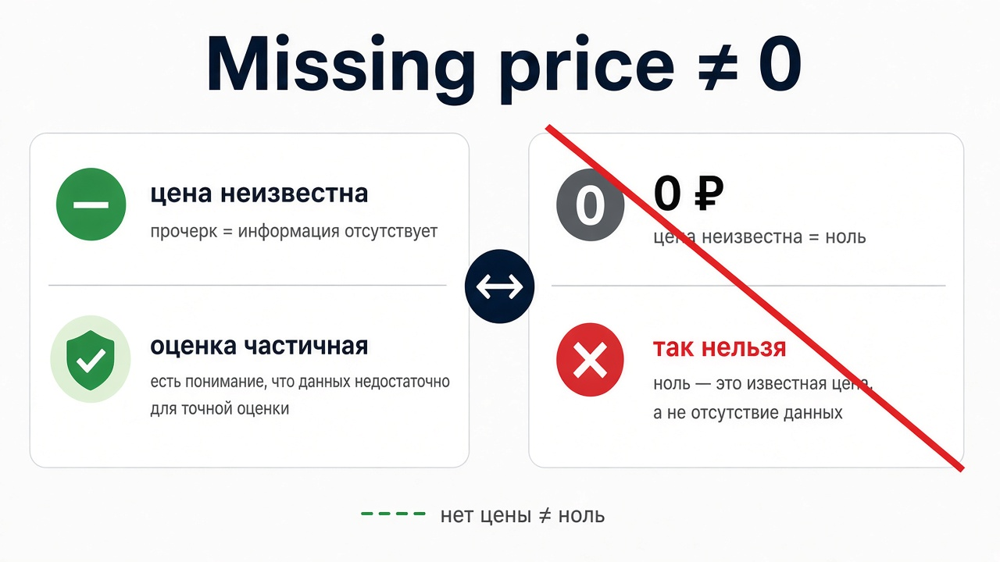

# Missing price ≠ zero

## Визуальный ориентир

*Неизвестное нельзя подменять нулём. Иллюстрация Vault; не скриншот приёмки и не доказательство runtime.*

Если цены нет, значение неизвестно. Ноль — конкретное число: бумага ничего не стоит, комиссия бесплатна, сигнал нейтрален, доходности не было. Это разные миры.

Правило повторяется в нескольких местах, потому что ноль удобно рисуется в интерфейсе:

- нет котировки — позиция не оценивается в ноль (Hub, PR #91);
- нет комиссии в тарифе — комиссия не 0% (Shadow и личный контур с 1.02);
- нет банковского фундаментала — не подставляют промышленные коэффициенты и не делают вид, что «отклонение ноль», то есть нейтрально;
- UNKNOWN не равен NEUTRAL, воздержание — нормальное состояние комитета;
- нет себестоимости — P&L пустой, даже если цена есть;
- нет P&L решения — не показывают 0 ₽ «по этой сделке»;
- прерванный запрос статуса на экране инструментов не должен притворяться честным состоянием NONE.

## Пример

Портфель из одной бумаги, цена не пришла. Показать 0 ₽ и просадку 100% — авария. Показать «оценка недоступна» — нормальная работа системы в плохой день данных.

Другой пример: плечо комиссии не сопоставилось с тарифом. Записать 0 ₽ комиссии — завысить результат и разрешить покупку, на которую кэша с учётом тарифа не хватает. Daily Decision как раз требует: сумма сделки и комиссия не больше доступного кэша. Неизвестная комиссия ломает это сравнение честно, нулевая — ломает тихо.

См. [[Фейковый ноль]] и [[Evidence level]].
