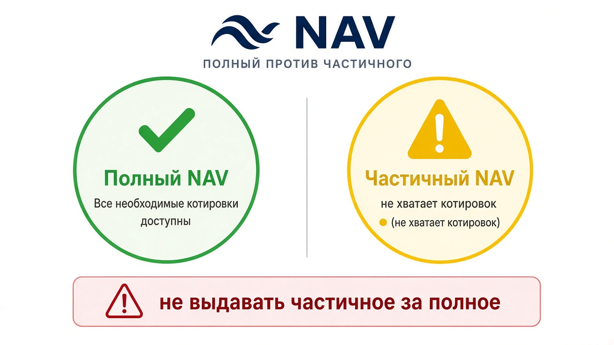

# NAV и Partial NAV

## Визуальный ориентир

*Частичное не выдавать за полное. Иллюстрация Vault; не скриншот приёмки и не доказательство runtime.*

NAV (net asset value) здесь — стоимость портфеля: кэш плюс оценённые бумаги минус то, что по правилам учёта вычитается. Для личного портфеля в рублях это «сколько сейчас стоит книга», а не «сколько я заработал».

**Полный NAV** можно называть полным, только когда все учитываемые позиции имеют пригодную цену на нужный момент.

**Частичный NAV** — сумма того, что оценить смогли, плюс явная пометка, что часть бумаг вне суммы. Частичный не показывают как полный и не строят по нему «полную» доходность.

**Недоступно** — когда честной суммы нет вообще. Это отдельное состояние, не ноль.

## Пример

Кэш 10 000 ₽. Акции А: 20 штук × 200 ₽ = 4 000 ₽. Акции Б: 5 штук, цены нет.

Полный NAV неизвестен. Известная часть: 14 000 ₽ плюс «Б не оценена». Написать 14 000 ₽ как всю стоимость — спрятать Б. Написать 0 ₽ за Б и итог 14 000 ₽ как полный — сделать вид, что Б ничего не стоит и её можно не заметить. Оба варианта ломают доверие. Правильный вид: известная часть 14 000 ₽, качество PARTIAL, одна позиция без цены.

PR #91 как раз чинил ложный ноль по бумагам, которые не удалось оценить, и развёл полную и частичную оценку Hub. Накладка в браузере, которая рисует частичность искусственно, не доказывает, что backend так ответил.

## Кэш

Кэш — полноценная позиция, не остаток «после запятой». Карточка списка портфелей должна говорить о стоимости, а не только о кэше и числе строк. Решение владельца 2026-10-29 исполнилось кодом Hub; качество формулировки на экране всё равно проверяют глазами на известном mount.

См. [[Missing price ≠ zero]] и [[Плохой NAV]].
