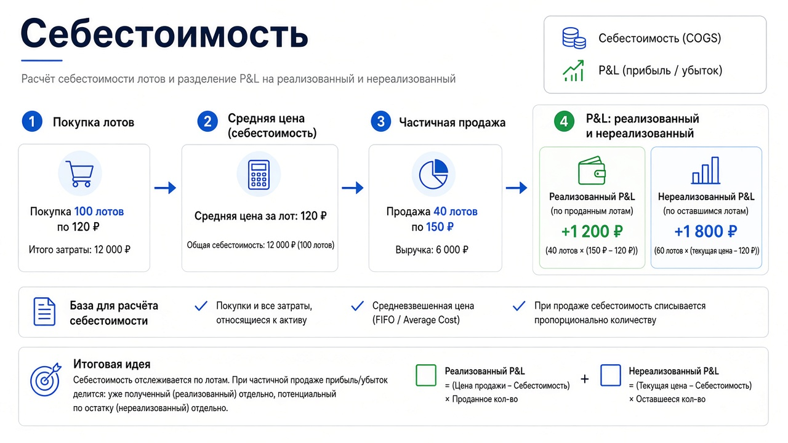

# Realized vs Unrealized P&L

## Визуальный ориентир

*Считать раздельно, не смешивать с депозитом. Иллюстрация Vault; не скриншот приёмки и не доказательство runtime.*

**Реализованный результат** появляется, когда позиция уменьшилась: продажа, погашение, иное закрытие части. Сравнивают полученное и списанную себестоимость. Пока бумага лежит, этот результат не «плавает» вместе с котировкой.

**Нереализованный результат** — разница между текущей оценкой ещё открытого остатка и его себестоимостью. Он изменится завтра, если изменится цена, и исчезнет как нереализованный в момент продажи, перейдя в реализованный.

Это разные карманы. Их сумма не равна «NAV сегодня минус NAV вчера» и не равна «сколько я заработал», если за день ещё внесли деньги.

## Пример

Остаток из примера себестоимости: 15 акций, база 1 657,50 ₽. Цена стала 130 ₽. Оценка 1 950 ₽. Нереализованный результат +292,50 ₽. Реализованный сидит в уже проданных 5 акциях и от сегодняшней цены не зависит.

Если цены нет, нереализованный результат неизвестен. Подставлять ноль — сказать, что бумага куплена по рынку и прибыли нет. Это другая, ложная история.

Если себестоимости нет, а цена есть, NAV может включать бумагу, а строка P&L остаётся пустой. Протокол прямо так и требует: отсутствующая база не блокирует оценку и не фабрикует прибыль. Цена покупки не подменяет рыночную.

## Дивиденды

Полученный дивиденд — доход, не рост цены. В наблюдении Personal Decision Memory версии 1.03 смотрят PRICE_RETURN и прямо пишут, что дивиденды не включены. Нельзя назвать этот процент полной доходностью владельца.

Инвестиционный P&L портфеля в модели V2: NAV минус чистый внесённый капитал. Пока нет полной декомпозиции на реализованное, нереализованное и доход, эту формулу не выдают за годовую XIRR.
