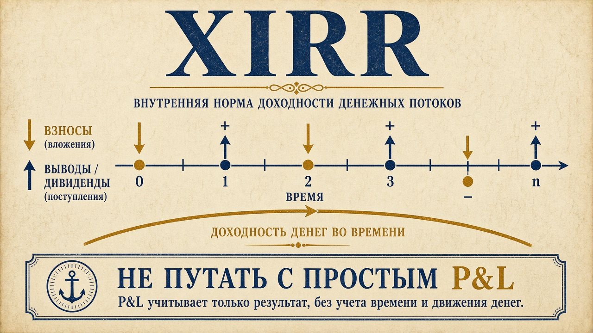

# XIRR

## Визуальный ориентир

*Доходность денег во времени. Иллюстрация Vault; не скриншот приёмки.*

XIRR — внутренний процент доходности при денежных потоках в разные даты. Вклад в январе и вклад в ноябре не должны считаться так, будто оба пролежали весь год. Формула ищет ставку, при которой приведённая стоимость потоков и конечной оценки сходится.

Это денежно-взвешенная доходность. Она отвечает «как работали мои деньги с учётом того, когда я их вносил», а не «как работала стратегия, если бы сумма была постоянной».

## Маленький пример

1 января внесли 100 000 ₽. 1 июля внесли ещё 100 000 ₽. 31 декабря оценка 210 000 ₽. Прибыль в рублях 10 000 на средний капитал, но годовая ставка не равна 10 000 / 200 000. Вторые сто тысяч работали полгода. XIRR будет выше, чем 5%, потому что те же 10 000 заработаны на капитале, который не весь год был полным. Точную ставку считают по датам, не «примерно 7% в разговоре».

Если 31 декабря оценки нет, XIRR не ставят в ноль и не считают от вчерашней частичной суммы, молча назвав её полной.

## Чем XIRR не является

- не изменением NAV за день;
- не прибылью, в которую затесался новый вклад;
- не time-weighted return. TWR как раз пытается убрать влияние моментов ввода денег и требует надёжных оценок на эти моменты. Пока оценок нет, TWR тоже недоступен, а не равен нулю;
- не ставка ЦБ. Ключевая ставка в Kraken — ориентир-препятствие для избыточной доходности исследования, не процент на кэш портфеля и не «безрисковый депозит».

Модель мультипортфеля V2 прямо оставляет TWR/XIRR за объёмом текущей версии. Появление метрики — работа Gate 1, с эталонными проводками. До неё экран не должен обещать «годовых».
