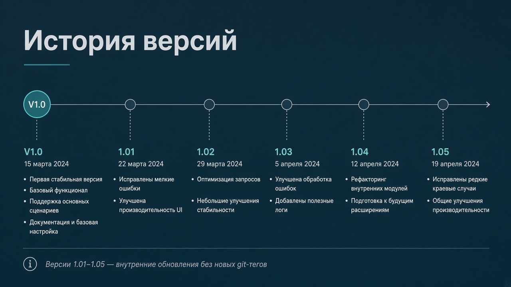

# История версий

## Визуальный ориентир

*Техн. 1.0.0 и продукт 1.01–1.05. Иллюстрация Vault.*

**Снято с `origin/main`:** `73c2e25e6aed323174b11dea4514946d5897f54b`  
**Дата записи:** 2026-11-23

Две линейки нельзя смешивать.

| Линия | Где живёт | Текущее значение на этом SHA |
|---|---|---|
| Технический SemVer | корневой `VERSION`, `app.__version__`, `KRAKEN_VERSION` | **1.0.0** |
| Продуктовая подпись для инвестора | `frontend/src/version/manifest.ts` → `KRAKEN_PRODUCT_VERSION` | **1.05** |
| Git-тег официального релиза | только `v1.0.0` среди продуктовых отметок 1.0.0…1.05 | тег есть у V1.0 |

Ранние технические теги `v0.1.0-foundation` … `v0.45.0-dividend-coverage-entitlement-survivorship-v2` есть в репозитории. Они отмечают инженерные вехи до Kraken V1.0 и **не** являются отдельными продуктовыми номерами 1.01–1.05.

Манифест прямо говорит: 1.01 / 1.02 / 1.03 / 1.04 / 1.05 — product micro-releases **без** git tag и GitHub Release. Заметки 1.01 восстановлены из локальной правки frontend 28.09.2026 на ветке `feature/brain-foundation-v2`, которая **не пушилась** и пропала из main после merge BFV2. Дата 2026-09-28 в манифесте поэтому относится к тексту заметок, а не к отдельному тегу.

## Зафиксированные продуктовые записи

| Дата | Версия | Подпись | Тег | Что обещает заметка | Чего заметка не обещает |
|---|---|---|---|---|---|
| 2026-09-27 | 1.0.0 | Kraken V1.0 | `v1.0.0` | Первый рабочий релиз: портфель, рекомендации, догон MOEX, Shadow catch-up, USER/OWNER как режим показа, desktop | Production IAM, автономная торговля, доказанная доходность |
| 2026-09-28 | 1.01 | Kraken 1.01 | нет | Multi-Portfolio, DRAFT/ACTIVE, новый капитал в Daily Decision, Dataset V3 только research, Candidate остаётся на V2 | Переключение production Candidate |
| 2026-09-29 | 1.02 | Kraken 1.02 | нет | Комиссии FeeEngine, Shadow Realism V3, Decision Journal, неизвестная комиссия не ноль | Реальные брокерские сделки |
| 2026-09-30 | 1.03 | Kraken 1.03 | нет | Personal Decision Memory, горизонты 5/20/60, PRICE_RETURN без дивидендов, operating protocol | Сохранение рекомендации не создаёт сделку |
| 2026-10-04 | 1.04 | Kraken 1.04 | нет | Dataset V4 research-only, Research Evidence, каноническая кампания: V4_FULL не улучшил OOS относительно BASE | Winner, promotion Candidate, production-ready сигнал |
| 2026-10-07 | 1.05 | Kraken 1.05 | нет | Intelligence Stack: Company Intelligence, комитет, intraday 60m, FNS, новости CBR/MOEX, macro, risk scenarios | Банковские фундаменталы на весь universe, исторический news OOS 2023, глубокая история 60m, денежная автономия |

SHA релиза V1.0 в манифесте: `b815b1ae389e18c0c1a2a922007e543f214d9fde` (PR #62, changelog).  
PR #61 `abbb6718cce0bc3cc21cb396162dd99be031c0a9` — versioning и экран «О Kraken».

Для 1.05 манифест указывает merge PR #79 `58283d8118de2cfd36bd490ad9b3a4ffd9450234` и reviewed feature HEAD `df7ed50bb6235079cd3f147e9d916bb32dab276f`. Число тестов «1379 passed, 8 skipped» взято из `technicalNotes` манифеста, в этом сеансе CI заново не гонялся.

Для 1.04 в заметках есть fingerprint канонического dossier и отрицательный результат V4_FULL против BASE. Это зафиксированный baseline, не маркетинговый успех.

## Что вышло в main после 1.05 и не стало новой версией

Owner не объявлял релиз после 1.05. Поэтому в манифесте нет 1.06, хотя в git после 7 октября есть существенные merge:

- 2026-10-12 PR #81 intelligence activation
- 2026-10-13 PR #82 historical backfill
- 2026-10-28 PR #84 investor journey, PR #86 async reliability
- 2026-10-29 PR #85 Shadow reliability, PR #91 Portfolio Hub NAV
- 2026-10-30 PR #98 Design System V2, PR #99 Decision Journal Variant 4

Journal V4 смержен и **не принят** владельцем как продукт. См. [[2026-10-30 — Отказ принять Journal V4]].

## Правило на будущее

Номер в `VERSION` и запись в `KRAKEN_RELEASES` появляются только когда Owner явно объявляет релиз. Эта заметка Vault номер не повышает.
