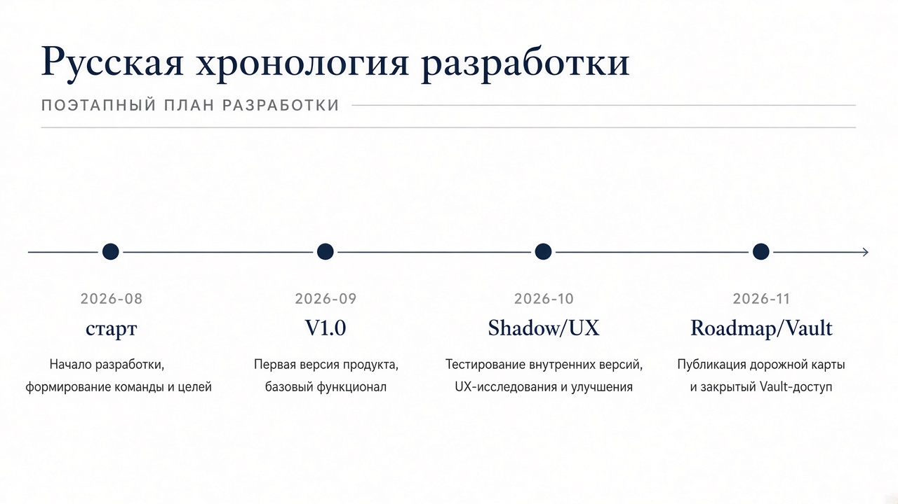

# Ключевые этапы

## Визуальный ориентир

*Крупные эпохи разработки. Иллюстрация Vault.*

**База:** `origin/main` `73c2e25e6aed323174b11dea4514946d5897f54b`  
**Дата записи:** 2026-11-23

Этап ниже — это смысловая веха, а не автоматический «следующий спринт». Статус говорит, что уже лежит в `main`, а что осталось планом.

## 1. Платформа и рыночные факты

**Когда:** 2026-08-21 … 2026-09-03  
**В main:** Docker-first монолит, Market Data V1, Analytics, Relations, Technical, Dataset PIT v0, сырая история, корпоративные действия, идентичность инструментов.  
**Статус кода:** смержено.  
**Приёмка владельца как продукта Kraken V1.0:** позже, 2026-09-27.  
**Смысл:** сырые свечи не переписываются; корпоративные действия — отдельные события; признаки считаются point-in-time.

## 2. Контур решения, ещё не брокер

**Когда:** 2026-09-04 … 2026-09-15  
**В main:** prediction candidate, historical simulator, policy/risk research, forward signal, Shadow V0, затем реализм Shadow, intraday execution, portfolio builder / candidate, fixed income, dividend lifecycle.  
**Статус:** смержено пакетами PR. Это не автономная торговля. Prediction, policy, risk и execution остаются разными ролями.  
**Не доказано:** экономическое превосходство моделей.

## 3. Первый именной релиз

**Когда:** 2026-09-27  
**В main:** тег `v1.0.0`, changelog, экран «О Kraken», Shadow EOD recovery (PR #60).  
**Статус:** релиз объявлен. USER/OWNER — режим показа, не IAM.  
**Подробнее:** [[2026-09-27 — Релиз Kraken V1.0]]

## 4. Персональный контур и память решений

**Когда:** 2026-09-28 … 2026-09-30  
**В манифесте:** 1.01, 1.02, 1.03.  
**В git:** Multi-Portfolio #68, Dataset V3 + Daily Decision V2 #69, Decision Memory #73, operating protocol #72.  
**Статус кода:** смержено.  
**Граница:** журнал личных операций — источник правды по личному портфелю; рекомендация в памяти не создаёт сделку. Dataset V3 не стал production Candidate.

## 5. Честный research baseline

**Когда:** 2026-10-03 … 2026-10-04  
**В main:** Dataset V4 и Research Evidence Engine. Продукт 1.04 фиксирует, что V4_FULL не улучшил OOS относительно BASE.  
**Статус:** смержено как research, **без** promotion Candidate.  
**Следствие для бэклога:** Dataset V5 не авторизован. См. исследование «Dataset V5 отложен».

## 6. Intelligence как совет, не как исполнитель

**Когда:** 2026-10-07 … 2026-10-13  
**В main:** Intelligence Stack 1.05, затем activation #81 и bounded backfill #82.  
**Статус:** код в main. Ограничения 1.05 (банки, новости вперёд, ML abstain, нет глубоких 60m) остаются в заметке версии.  
**Не заявлено:** денежная автономия и исторический news OOS.

## 7. Надёжность портфеля и хаба

**Когда:** 2026-10-28 … 2026-10-29  
**В main:** путь инвестора #84, защита от устаревшего async в части портфеля и Decision Memory #86, Shadow reliability #85, общая стоимость на карточке хаба #91 с правилом missing ≠ 0 для этой оценки.  
**Статус merge:** Owner разрешил #85 и #91 2026-10-29.  
**Остаток:** полный live Shadow catch-up в контексте назван не подтверждённым. PR B и PR C записаны как PLANNED и к 2026-11-23 PR не получили.

## 8. UX-рой и отказ по журналу

**Когда:** 2026-10-29 … 2026-10-30  
**В main:** план swarm #96, Design System V2 #98, Journal Variant 4 #99.  
**Приёмка:** технический merge #98/#99 не равен приёмке экрана. Owner отклонил видимый журнал. Открытые #100/#101 на момент снимка контекста чинят чтение и подачу, но не считают P&L решения.  
**Блокер показа:** скриншоты владельца не совпали с уже смерженным UI; вероятная причина — старый bind-mount frontend. Гипотеза не подтверждена `docker inspect` в этом сеансе.

## 9. Продуктовый план без брокера и память Vault

**Когда:** 2026-11-19 … 2026-11-23  
**В main:** competitive roadmap и расширение Master Context про локальный Vault.  
**Статус:** решение о направлении и о способе вести знания. Реализация Gate 0–5 **не** начата этим документом. Импорт брокерских счетов запрещён решением, а не «временно отложен».

## Порядок, который уже выбран, но не стартовал

1. Сначала честный ручной ledger и видимый инвесторский контур (Gate 0, включая проверку Docker-mount и PR B).  
2. Затем себестоимость и XIRR-класс метрик (Gate 1) — только после явной волны Owner.  
3. PR C — после PR B, оба всё ещё PLANNED.  
4. P&L, отнесённый к решению, — после лотовой себестоимости, не внутри текущего UI #101.  
5. Сеть, порты, firewall и auth — DEFERRED отдельным решением 2026-10-28.
