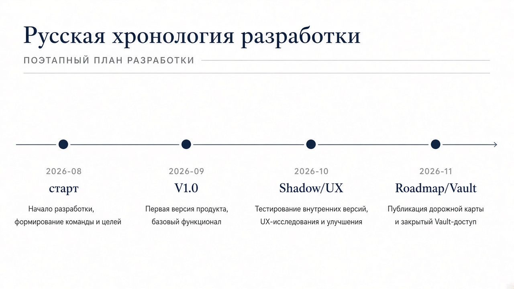

# Хронология Kraken

## Визуальный ориентир

*Крупные эпохи 2026. Иллюстрация Vault; не скриншот приёмки и не доказательство runtime.*

**Записано:** 2026-11-23  
**База:** `origin/main` `73c2e25e6aed323174b11dea4514946d5897f54b`  
**Источники:** `git log origin/main`, `CHATGPT_MASTER_CONTEXT.md` на этом SHA, `frontend/src/version/manifest.ts`, `CHANGELOG.md`, `docs/technical-debt.md`  
**Живой опрос GitHub API в этом сеансе не делался.** Открытые PR ниже — снимок Master Context, который сам лежит в `main`. Перед планированием статус PR нужно перепроверить.

Технический SemVer в корневом `VERSION` остаётся **1.0.0**. Подписи Kraken 1.01–1.05 — продуктовые микрорелизы в манифесте, **без** git-тега и GitHub Release.

## Как читать статусы

Смерженный PR не равен приёмке владельца и не равен «проверено в работающем Docker». Уровни разделены в карточках проблем и в бэклоге.

## Линия

| Дата | Событие | Доказательство |
|---|---|---|
| 2025-10-16 | Первый коммит репозитория `d928d6f915960c4a3eb5ed91390e48a2248d5c3f` | `GITHUB_VERIFIED` (git). Содержимое «Initial commit» в этой волне пофайлово не разбиралось |
| 2026-08-21 | Платформа: bootstrap `4bad4c89742363f9a32f1a7802b9aeb442452622`, merge PR #1 `78fd83787a2ea99edd207c239c0970ea82b4a89d` | `GITHUB_VERIFIED` |
| 2026-08-30 | Market Data V1, PR #2 `49171fa04fbab999df48decb1e887db22fe72b58` | `GITHUB_VERIFIED` |
| 2026-08-31 | Analytics V1, PR #3 `ed4322f0d14d9e4925ba1f26ebb779f2471a3f6d` | `GITHUB_VERIFIED` |
| 2026-09-01 | Relations V1 #4, Technical V1 #5 `4fe56b553ddfd73b26774111280d5d7c26ac3404` | `GITHUB_VERIFIED` |
| 2026-09-03 | Dataset PIT, deep history, corporate actions, instrument identity, source windows (PR #6–#13) | `GITHUB_VERIFIED` по merge-коммитам |
| 2026-09-04 | Prediction candidate, simulator, policy/risk, forward signal, Shadow V0, explanation UX (PR #14–#25) | `GITHUB_VERIFIED` |
| 2026-09-05…15 | Fixed income, portfolio builder, dividend lifecycle, fundamentals foundation (PR #29–#57) | `GITHUB_VERIFIED` по сообщениям merge |
| 2026-09-27 | Официальный релиз **Kraken V1.0**, тег `v1.0.0`, дата в манифесте `2026-09-27`, SHA релиза `b815b1ae389e18c0c1a2a922007e543f214d9fde` (PR #62). Рядом PR #61 versioning и PR #60 Shadow recovery | `GITHUB_VERIFIED` |
| 2026-09-28 | Продукт **1.01** (манифест). В git того дня: Multi-Portfolio V2, PR #68 `35e56e7f55b7e47968dc573aa74cdd0d3201d04c` | дата продукта — манифест; PR — git |
| 2026-09-29 | Продукт **1.02**. PR #69 Dataset V3 + Daily Decision V2 `cce199400f8127d3c1b8b562d0ce4121c4b81ce4` | манифест + git |
| 2026-09-30 | Продукт **1.03**. PR #73 Decision Memory `788a297202319136c908a147921a4377aa21f60f`, микрорелиз #74 `767a6f1c5b7037c6bc382b20d47e202324ee6caf`, operating protocol #72 | манифест + git |
| 2026-10-03 | Dataset V4 #75 `9b40854ffead508fd2fe4a98d6b3425a0eea4b25`, Research Evidence #76 `dfc4db718808fd940bd577bcf85d1afc7b41b053` | `GITHUB_VERIFIED` |
| 2026-10-04 | Продукт **1.04**, canonical evidence #77, релизный merge #78 `55fdf76c9127a4c929ccb51f6ee7be5d0824e27f` | манифест + git |
| 2026-10-07 | Продукт **1.05** Intelligence Stack, PR #79 `58283d8118de2cfd36bd490ad9b3a4ffd9450234`, релизный merge #80 `ae9650f6c7f6c750457691d8add7fb890c082e1a` | манифест + git. Прибыльность не заявлена |
| 2026-10-12 | Intelligence activation PR #81 `b7d778a57912ddc08e03e2e686a3e2132e3bac82` | `GITHUB_VERIFIED`. Это не новый продуктовый номер |
| 2026-10-13 | Historical ingestion backfill PR #82 `76877439351559e25d7ed35f2cdecedd25c1bb97` | `GITHUB_VERIFIED` |
| 2026-10-28 | Investor journey #84; frontend async #86 (fix `775237298f615cb32f75da9ca7b9cd8250bbbef2`, merge `0846bd896f33fea049377671e0d4888eef9565ba`); Master Context #87; политика контекста #88. Owner: сеть **DEFERRED**, PR B и PR C **PLANNED** | git + Master Context |
| 2026-10-29 | Owner разрешил merge #85 и #91. #85 `a1c165b5d6378cff8e7cfae86a2aaf79199e4a1a`. #91 `512628b2798bc81f91a480769e08adfcdbe6169d`. Выбран Journal Variant 4 (направление UX, не сразу код). PR #96 — план swarm | git + Master Context |
| 2026-10-30 | Смержены #98 Design System `8fbea8d5d2b3098658b85689ca1ed04126c9d290` и #99 Journal V4 `95f2fd857764448168343d22bacf8e49ed445d29`. Owner **отклонил** видимый журнал. Скриншоты показали старый UI при уже смерженном коде — гипотеза stale Docker mount. Политика risk-based CI. Открыты #100 и #101; P&L решений в них нет | merge = git; отказ и скриншоты = `REPORTED_BY_OWNER`; причина mount = гипотеза |
| 2026-11-19 | Competitive roadmap без импорта брокера, коммит `652fbaa1d8f3d9da139e2e5b46c0777f5124e8a9`. Это план, не разрешение кодить Gate 1–5 | `GITHUB_VERIFIED` текст в main; статус плана = `PROPOSED` |
| 2026-11-23 | Vault: сначала локально `E:\kraken Vault`, Git позже. Затем расширение Vault до истории, проблем и бэклога. Текущий main — этот SHA | решение Owner записано в Master Context на main |

## Что сознательно не дорисовано

- Пофайловый разбор всех PR #6–#57. В месячнике сентября они сгруппированы по темам merge-сообщений.
- Независимый `docker inspect` машины владельца.
- Повторный опрос `gh` по #100, #101, #97, #83, #58. В снимке контекста они **OPEN**. Номеров PR B и PR C нет: работы не начинались.

## Куда идти дальше

- Помесячно: [[2026-09]], [[2026-10]], [[2026-11]]
- Версии: [[История версий]]
- Этапы: [[Ключевые этапы]]
- Архитектура: [[Значимые архитектурные изменения]]
- Решения: каталог `История решений владельца`
- События: каталог `События`
