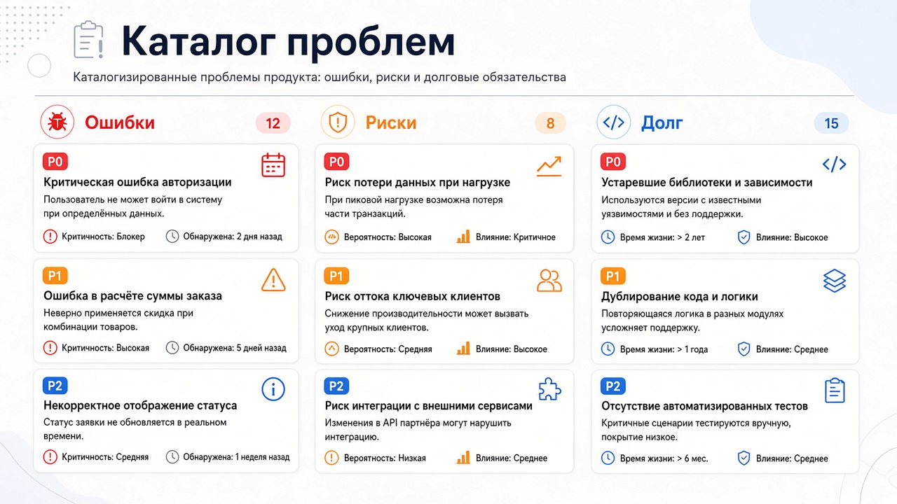

# Все проблемы

## Визуальный ориентир

*Ошибки, риски и долг. Иллюстрация Vault; не скриншот приёмки и не доказательство runtime.*

Индекс каталога проблем Kraken. Карточки живут в `Карточки проблем/`.  
Статусы GitHub Issues/PR всегда сверять с GitHub; эта страница — человеческий указатель.

**Baseline:** 2026-11-23 · main `73c2e25…`  
**См. также:** [[Индекс проблем]] · [[Проблемы по приоритету]] · [[Проблемы по статусу]] · [[Проблемы по типу]]

## Критические (P0)

| ID | Кратко | Статус |
|---|---|---|
| [[KRK-BUG-0001]] | Устаревший Docker bind-mount frontend | open / hypothesized cause |
| [[KRK-UX-0001]] | Journal V4 смержен, но Owner rejected acceptance | open |
| [[KRK-UX-0002]] | V4.1: нужны status pills; decision P&L отсутствует | open / in_review на PR |

Полный список критических: [[Критические проблемы]]

## Ошибки / UX

- [[KRK-BUG-0002]] — «детализация недоступна» при отсутствии `candidate_traces`
- [[KRK-BUG-0003]] — fills группируются по execution_date, а не lifetime ордеров дня сигнала
- [[KRK-BUG-0004]] — (см. карточку)
- [[KRK-UX-0001]] · [[KRK-UX-0002]]

## Риски

[[KRK-RISK-0001]] … [[KRK-RISK-0006]] — в т.ч. missing≠0, network deferred, Research/Personal смешение

## Техдолг

[[KRK-DEBT-0001]] … [[KRK-DEBT-0008]] (включая проекцию TD-* из `docs/technical-debt.md`)

## Закрытые

См. [[Закрытые проблемы]] — на 2026-11-23 большинство каталожных карточек ещё open.
