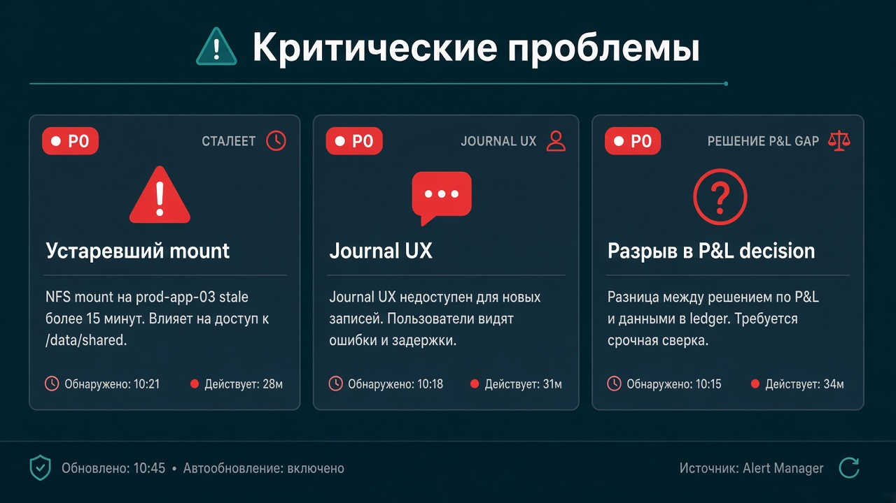

# Критические проблемы

## Визуальный ориентир

*P0 блокеры приёмки и честности UI. Иллюстрация Vault.*

P0 / блокеры приёмки и денежных инвариантов на снимке 2026-11-23.

| ID | Проблема | Почему P0 | Следующий шаг |
|---|---|---|---|
| [[KRK-BUG-0001]] | Stale frontend Docker mount | Любая UX-приёмка может смотреть не на `main` | `docker inspect` Mounts + маркеры исходников |
| [[KRK-UX-0001]] | Journal V4 ≠ Owner acceptance | Смерженный UI не принят продуктово | Не считать #99 закрытием UX; ждать V4.1 |
| [[KRK-UX-0002]] | Pills + отсутствие decision P&L | Owner явно запросил; #100/#101 P&L не считают | UI pills в #101; P&L — отдельный эпик [[KRK-EPIC-0007 Decision P&L]] |

Связанный горизонт: [[Сейчас]] · Epic [[KRK-EPIC-0006 Journal V4.1]]
