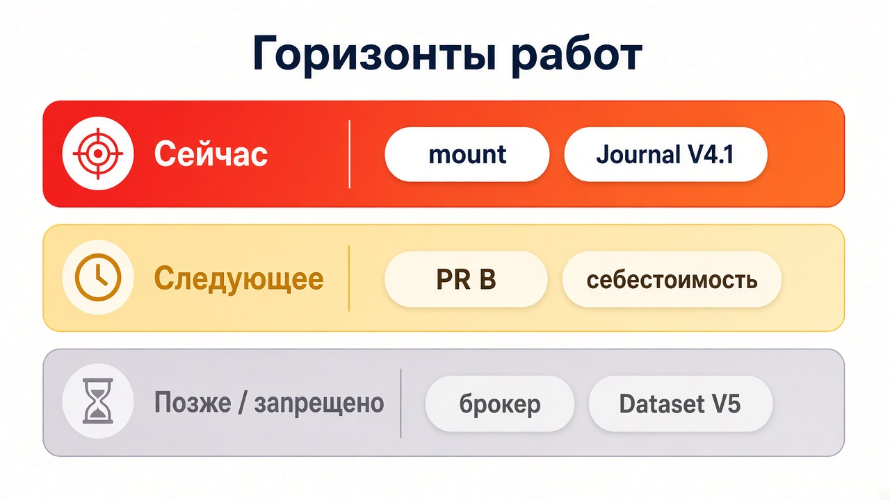

# Весь бэклог

## Визуальный ориентир

*Горизонты работ. Иллюстрация Vault.*

**Дата:** 2026-11-23  
**База:** `origin/main` `73c2e25e6aed323174b11dea4514946d5897f54b`  
**Роль файла:** указатель. Детали и критерии — в эпике или задаче, один раз.

Vault не исполняет работы. Номера открытых PR взяты из Master Context. Перед стартом код-задачи статус PR на GitHub нужно перечитать: `gh` в сеансе записи недоступен.

## Как устроены горизонты

| Файл | Что в нём лежит |
|---|---|
| [[Сейчас]] | То, что уже открыто или блокирует честную приёмку. Новый финансовый код не стартует |
| [[Следующее]] | Очередь, которую Owner уже назвал: PR B, затем PR C, плюс базовая приёмка после mount |
| [[Позже]] | Волны roadmap без выбранного старта |
| [[Заблокировано]] | Ждёт другое решение, другой эпик или запрет Owner |
| [[Завершено]] | Уже в `main` или закрыто в файле долга. Приёмка экрана указана отдельно |

## Эпики

| ID            | Эпик                               | Статус             | Приоритет      |
| ------------- | ---------------------------------- | ------------------ | -------------- |
| KRK-EPIC-0001 | Gate 0, надёжный базовый контур    | proposed           | P0             |
| KRK-EPIC-0002 | PR B, целостность операций         | approved, не начат | P1             |
| KRK-EPIC-0003 | Себестоимость и денежный результат | blocked            | P0 после волны |
| KRK-EPIC-0004 | Доход: дивиденды и купоны          | proposed           | P1             |
| KRK-EPIC-0005 | Аналитика, бенчмарк, ребаланс      | proposed           | P1             |
| KRK-EPIC-0006 | Journal V4.1                       | in_review          | P1             |
| KRK-EPIC-0007 | Decision P&L                       | blocked            | P1             |
| KRK-EPIC-0008 | PR C, загрузка данных              | approved, не начат | P2             |

## Технические задачи

| ID | Статус | Зависит от | Эпик |
|---|---|---|---|
| KRK-TASK-0001 | ready | — | Gate 0 |
| KRK-TASK-0002 | in_review | mount для приёмки | Journal V4.1 |
| KRK-TASK-0003 | in_review | KRK-TASK-0002 | Journal V4.1 |
| KRK-TASK-0004 | approved | разрешение начать PR B | PR B |
| KRK-TASK-0005 | approved | KRK-TASK-0004 в том же PR | PR B |
| KRK-TASK-0006 | approved | эпик PR B закрыт merge | PR C |
| KRK-TASK-0007 | approved | #86 уже в main; старт после B | PR C |
| KRK-TASK-0008 | ready | свежий main | — |
| KRK-TASK-0009 | blocked | волна Owner + PR B | себестоимость |
| KRK-TASK-0010 | blocked | KRK-TASK-0009 | Decision P&L |
| KRK-TASK-0011 | proposed | отдельное разрешение менять workflows | инфра |
| KRK-TASK-0012 | blocked | KRK-TASK-0001 | Gate 0 |

## Исследования

| ID | Статус |
|---|---|
| KRK-RES-0001 Dataset V5 | deferred |
| KRK-RES-0002 PR #58 дивидендный PIT | in_review как открытый PR, не план merge |
| KRK-RES-0003 археология делистинга | proposed, не старт |

## Возможности

Идеи продукта без разрешения реализовать: бенчмарк, цели, экспорт своих записей, мобильная оболочка, список наблюдения, объяснение решения простым языком.

## Сознательно нет в бэклоге как работа

Импорт брокерских счетов, отчётов и сделок. Отправка заявок брокеру. Поднятие `VERSION`. Публикация Vault в git. Сетевой hardening, пока действует KRK-RISK-0004.
