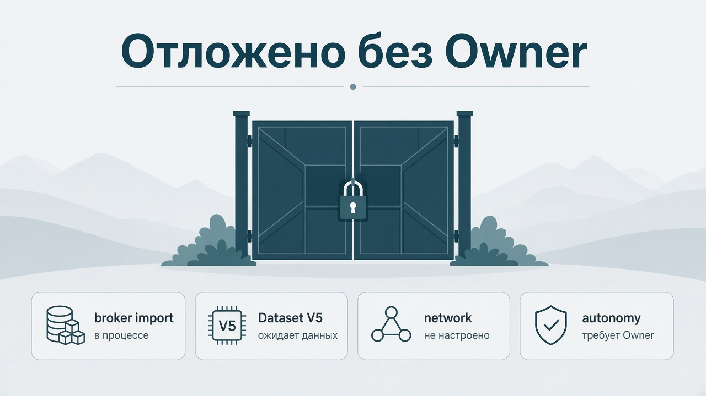

# Заблокировано

## Визуальный ориентир

*Ждём зависимость или решение Owner. Иллюстрация Vault.*

**Дата:** 2026-11-23

| Что | Чем блокируется | Что снимет блок |
|---|---|---|
| KRK-TASK-0012 смотр UI | Неизвестно, какой frontend смонтирован | KRK-TASK-0001 |
| Приёмка Journal V4 и V4.1 | Отказ Owner + возможный чужой mount | Новый SHA в правильном браузере и явное accepted |
| KRK-TASK-0010 P&L решения | Нет лотовой себестоимости и тестов когорт | KRK-TASK-0009 в main |
| KRK-EPIC-0003 себестоимость | Волна Owner не выбрана; PR B не смержен | Выбор волны и закрытый B |
| KRK-EPIC-0004 и 0005 | Нет фундамента Gate 1 | Себестоимость и словарь метрик |
| KRK-TASK-0006 / 0007 | Owner поставил C после B | Merge PR B |
| Сеть и auth | Решение 2026-10-28 | Новый запрос Owner |
| Dataset V5 | Запрет расширения 2026-10-28, не снят | Отдельное решение |
| Merge #97 | Конфликт с более новым контекстом | KRK-TASK-0008 |
| Широкий live catch-up | Не входит в UX-починку; полный прогон не подтверждён | Отдельное операционное задание |
| Импорт брокера | Запрещён 2026-11-19 | Не планируется как обход |

Блокировка не означает дефект в git. Часть пунктов — правильная очередь.
