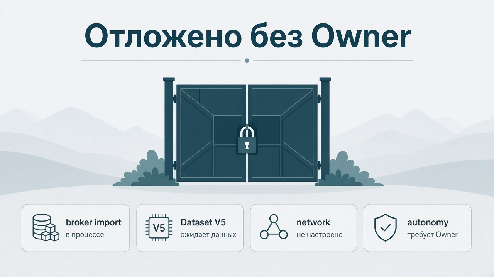

# Позже

## Визуальный ориентир

*Ценность есть, старт не разрешён. Иллюстрация Vault.*

**Дата:** 2026-11-23  
План 19 ноября. Это не спринты и не обещание дат.

| Когда по смыслу roadmap | Эпик или возможность | Почему не раньше |
|---|---|---|
| После доверенного журнала | KRK-EPIC-0003 себестоимость, реализованный и нереализованный P&L, XIRR где он считается | Нужны лоты, комиссии и честные пропуски |
| После себестоимости | KRK-EPIC-0004 календарь дивидендов и купонов | Иначе «ожидаемый доход» висит в воздухе |
| Параллельно только на согласованном контракте | KRK-EPIC-0005 аналитика, бенчмарк, ребаланс-предложение, цели | Ребаланс не исполняет сделки |
| После лотов | KRK-EPIC-0007 P&L решения | Нельзя атрибутировать то, чего нет в учёте |
| После учёта | Объяснение решения простым языком, Company Intelligence как повседневный слой | Сам стек 1.05 уже в main, продукт Gate 4 — нет |
| Отдельное разрешение | KRK-TASK-0011 фильтры CI | Политика 30 октября workflows не меняла |
| Новый запрос Owner | Сеть KRK-RISK-0004 | Явно deferred |
| Запрещено как ближайший шаг | Dataset V5, импорт брокера | Прямой текст контекста |

Возможности из соседней папки остаются идеями, пока их нет в выбранной волне.
