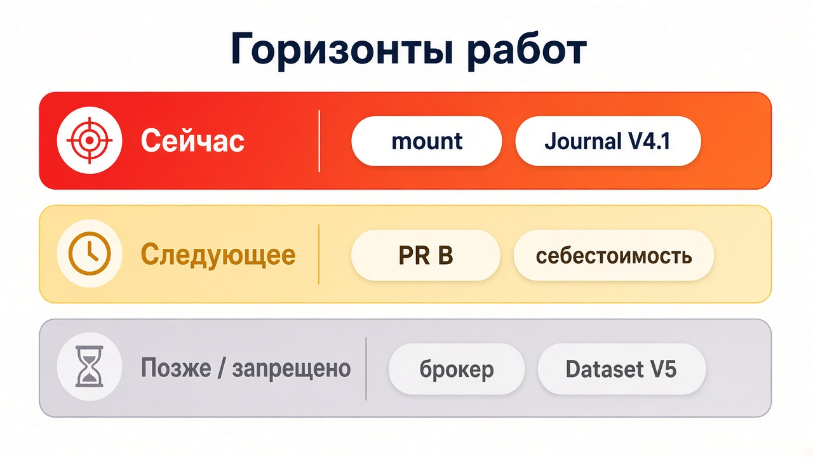

# Сейчас

## Визуальный ориентир

*Сейчас / следующее / позже. Иллюстрация Vault; не скриншот приёмки и не доказательство runtime.*

**Дата:** 2026-11-23  
Сейчас — это не разрешение писать Gate 1. Сейчас — то, без чего нельзя честно принять уже открытое.

## Сделать или досмотреть, не расширяя объём

1. **KRK-TASK-0001.** Выяснить, какой каталог смонтирован в frontend. Пока это не сделано, скриншоты UI не доказательство. Карточка KRK-BUG-0001.
2. **KRK-TASK-0002 и KRK-TASK-0003.** PR #100 и #101 на снимке контекста открыты. Их можно ревьюить. Merge Owner не выдавал. Пилюли без P&L. P&L в эти PR не добавлять.
3. **KRK-TASK-0008.** Свести #97 с журналом контекста до merge, чтобы не стереть решения октября и ноября.

## Что сейчас не начинать

- Новый код себестоимости, XIRR, календаря дохода, бенчмарка.
- Dataset V5.
- Правки портов и auth.
- Широкий Shadow catch-up ради журнала.
- Объявление Kraken 1.06.

## Почему журнал в «сейчас», а PR B в «следующем»

Журнал уже имеет открытые PR и вердикт Owner. PR B назван следующим объёмом разработки, но PR не создан и 19 ноября Owner ещё выбирает волну. Называть PR B «в работе» было бы ложью.
