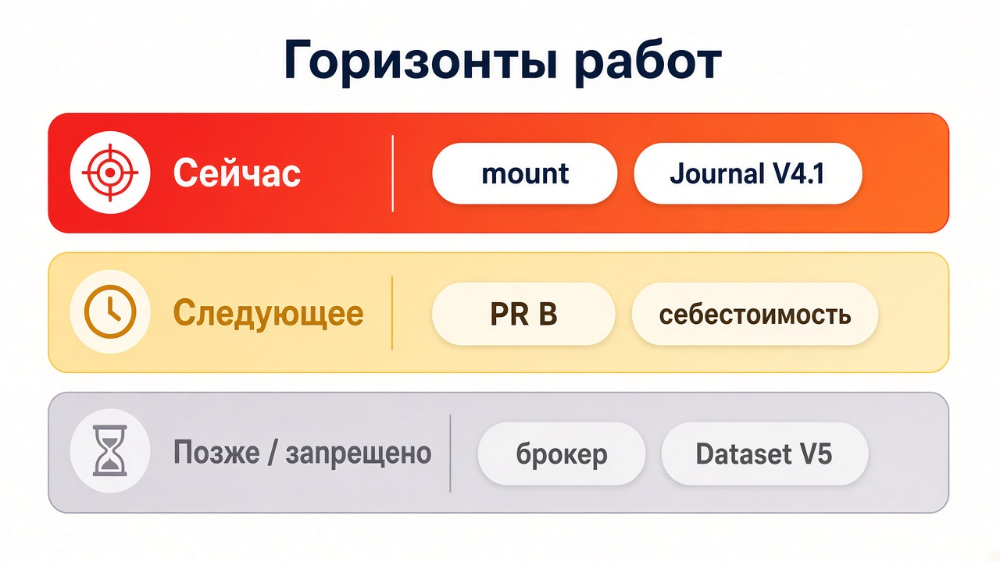

# Следующее

## Визуальный ориентир

*После текущего горизонта. Иллюстрация Vault.*

**Дата:** 2026-11-23  
Очередь зафиксирована 28 октября и уточнена Gate 0 от 19 ноября. Старт кода всё ещё ждёт, что ветка открыта человеком, а не самим фактом записи.

## Порядок

1. **KRK-EPIC-0002 PR B** целиком, задачи KRK-TASK-0004 и KRK-TASK-0005. Пока проводки и preview расходятся, ручной журнал не считается доверенным основанием для XIRR.
2. **KRK-EPIC-0008 PR C** после merge B, не вместо него. Задачи KRK-TASK-0006 и KRK-TASK-0007. #86 не переделывать.
3. **KRK-TASK-0012** смотр основных экранов инвестора на 1440 / 390 / 320, светлая и тёмная тема. Только после KRK-TASK-0001, иначе смотр идёт в старый mount.

## Определение «следующее началось»

Появляется PR с номером, SHA и запись в Master Context со статусом IN_PROGRESS. До этого эпики остаются approved / proposed, не in_progress.

## Не втягивать в B и C

Доступность переключателя портфелей, новые модели, Dataset V5, сеть, брокер, поднятие версии.
