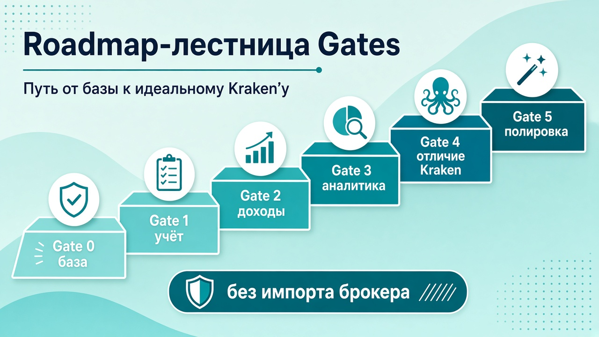

# Roadmap Kraken

## Визуальный ориентир

*Ступени без импорта брокера. Иллюстрация Vault; не скриншот приёмки и не доказательство runtime.*

Источник порядка работ — `docs/product/KRAKEN_COMPETITIVE_ROADMAP_NO_BROKER_IMPORT_2026-11-19.md`. Статус документа: предложенная поэтапная стратегия. Сам файл не разрешает ни реализацию, ни merge.

Три горизонта Vault:

| Горизонт | Содержание | Статус на 2026-11-23 |
|---|---|---|
| Сейчас | журнал V4.1 (#100/#101) ждёт приёмки; PR B целостности журнала; Gate 0 | не начато как утверждённый код, кроме уже слитых #98/#99, вид которых не принят |
| Следующее | себестоимость, P&L, XIRR, календарь дохода, P&L решения | план |
| Позже / нельзя без владельца | брокер, автономия, Dataset V5, сеть, массовый backfill | запрет |

## Волны

### Gate 0 — надёжная база кабинета (P0)

Проверка экранов 1440 / 390 / 320, светлая и тёмная тема. Сначала убедиться, какой worktree отдаёт localhost. Одна навигация и пять разделов. Общие форматы денег, процентов, дат. Демо-портфель: внесение, покупка, продажа, дивиденд, данные живы после обновления. PR B должен закончиться раньше, чем ручные штуки и комиссии объявят доверенными.

Приёмка: незнакомый человек создаёт портфель и операцию, понимает качество оценки, не видит технических id; нет расхождения исходников; клавиатура и узкий экран доступны.

### Gate 1 — журнал, которому верят (P0)

Быстрые операции: покупка, продажа, ввод и вывод денег, дивиденд, купон, комиссия, удержанный налог, амортизация и корпоративные действия там, где источник законный. Себестоимость с учётом частичной продажи, сплита и комиссии. Правка оставляет след. Метрики разделены: себестоимость, рыночная стоимость, реализованный и нереализованный P&L, доход, комиссии, налоги, XIRR. Денежный поток не смешивается с доходностью. Выгрузка только своих данных.

Приёмка: эталонный набор проводок сходится; нет цены или себестоимости — метрика недоступна, не ноль.

### Gate 2 — доходы (P1)

Календарь будущих, объявленных, оценённых и полученных выплат. Типы событий и даты реестра / отсечки / выплаты различны. Нет выдуманных дивидендов. Доходность к цене и к себестоимости, горизонты 30 / 90 / 365 дней. Покрытие провайдеров видно. Рыночное обогащение без доступа к счёту — только после правовой проверки.

### Gate 3 — аналитика сравнения (P1)

Один экран структуры и вклада бумаг. Бенчмарк с одинаковым календарём и валютой. Ребаланс учитывает кэш, лот, комиссию и остаётся предложением. Цели и «что если» показывают допущения. Сводка нескольких личных портфелей не включает Shadow.

### Gate 4 — отличие Kraken (P1/P2 после фундамента)

Совет на русском. Журнал с разными датами сигнала, решения и исполнения. P&L решения только после лотовой аллокации и цен as-of; его нельзя выводить из дневного изменения NAV. Оценка Shadow против базы с издержками. Company Intelligence остаётся объяснимой. Глубокий research — уровень OWNER.

### Gate 5 — полировка (P2)

Телефон, поиск, онбординг, уведомления по согласию, пользовательские активы только если их правда просят. Отдельная методика для неликвидных оценок.

## Как резать работу

Четыре полосы, не один рой на всё:

- целостность финансов — последовательно, не «косметический» рой;
- кабинет инвестора — непересекающиеся ветки;
- рыночные и фундаментальные факты — происхождение и PIT, без API счёта;
- проверка — эталонные проводки, демо, скриншоты браузера.

Календарь и визуальная аналитика могут идти рядом, если контракт уже согласован. P&L решения — после аллокации себестоимости. Спринт вёрстки не блокируют новой моделью. Финансовый PR не смешивают с чисто визуальным.

Интеллектуальный roadmap (`future-intelligence-roadmap.md`) в эту очередь не вставлен как обязательный Gate. Его место — [[AI и Intelligence]].
