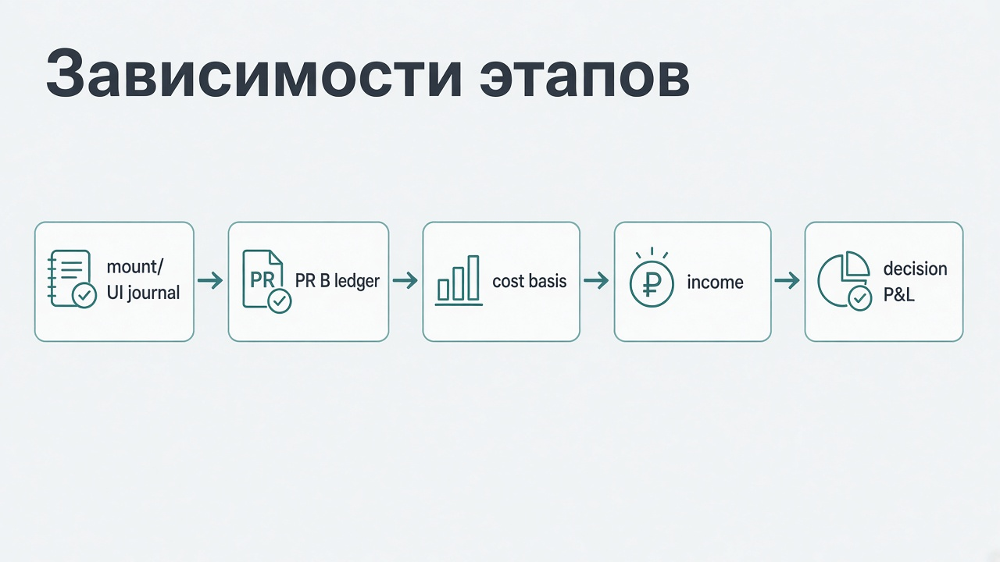

# Зависимости этапов


## Визуальный ориентир



*Порядок волн до decision P&L. Иллюстрация Vault.*

Стрелка значит «без левого правый легко соврать», а не «левое уже сделано».

```text
Проверенный mount и демо-кабинет (Gate 0)
        ↓
Целостность ручной операции, PR B
        ↓
Себестоимость, частичные продажи, комиссия один раз (Gate 1)
        ↓
┌───────────────────────┬────────────────────────┐
Календарь доходов       Аналитика и бенчмарк
(Gate 2)                (Gate 3) — на согласованном контракте оценки
└───────────────────────┴────────────────────────┘
        ↓
Лотовая аллокация покупок и продаж
        ↓
P&L, отнесённый к решению (Gate 4) — не из дневной дельты NAV
        ↓
Полировка, телефон, лишние классы активов (Gate 5)
```

## Жёсткие предпосылки

| Что хотим | Без чего нельзя |
|---|---|
| Доверять штукам и комиссии в журнале | PR B: одна эффективная величина, превью = запись, повтор запроса не двоит комиссию |
| Называть полный NAV | цены всех учитываемых бумаг либо явная частичность |
| XIRR | датированные внешние денежные потоки отдельно от рыночной переоценки |
| Календарь «будет дивиденд» | событие с происхождением; нет `ex_date` — нет даты, а не догадка «реестр минус день» |
| Бенчмарк | общий календарь, валюта, понятный total return или честная оговорка, что дивиденды индекса не входят |
| Ребаланс | лот, кэш, комиссия; предложение не уходит брокеру |
| P&L решения | несколько покупок, частичные продажи, as-of цена, комиссии входа и выхода; пропущенное звено показано |
| Смена Candidate | walk-forward, сравнение, явное повышение; V4-кампания такого повышения не дала |
| Любой брокер | отдельное разрешение владельца; сейчас запрещено |

## Что не блокирует друг друга

- цветные плашки статусов журнала (#101) и финансовый read-model P&L — разные работы; плашки не создают цифру;
- визуальный спринт Gate 0 не ждёт новой ML-модели;
- research PR #58 (дивиденды / календарь / universe) не сливается «заодно» с продуктовым календарём, пока владелец не соединит объёмы;
- документация и Vault не требуют полного CI.

## Что нельзя ставить в зависимость «потом починим»

Сеть и порты не являются хвостом PR B или PR C. Массовый backfill истории не является хвостом починки mount. Dataset V5 не является хвостом отрицательной кампании V4.

Открытые #100 и #101 зависят друг от друга (UI от read-model), но не зависят от Gate 1 и не закрывают запрос на P&L решения.
