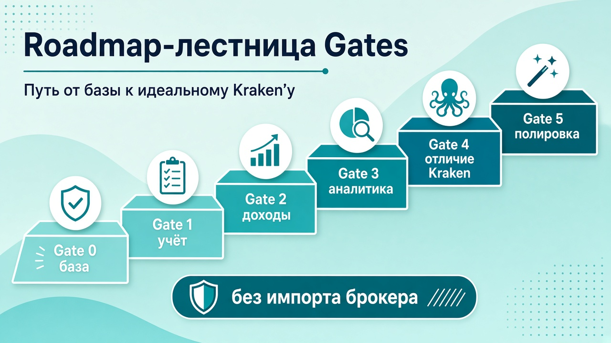

# Критический путь

## Визуальный ориентир

*Зависимости волн Gate. Иллюстрация Vault.*

Критический путь — самая длинная цепочка, без которой инвестор не может доверять деньгам на экране. Всё остальное может идти рядом, но не обгоняет эту цепь.

## Цепь

1. **Узнать, какой код реально открыт в браузере.** Пока frontend может быть примонтирован к старому worktree, любой скриншот спорит сам с собой. Это блокер приёмки с 2026-10-30, не теоретический риск.
2. **Довести ручной ввод до одной правды (PR B).** Превью, комиссия и журнальная строка описывают одну и ту же штуку и одну дату. Повтор не создаёт вторую комиссию.
3. **Закрыть эталон проводок Gate 1.** Внесение → покупка → дивиденд → частичная продажа → комиссия и налог → остаток. Суммы сходятся. Дыры помечены, не занулены.
4. **Только потом** календарь, бенчмарк и P&L решения.

Пока шаг 3 не зелёный, «умный» журнал решений остаётся витриной. Владелец уже попросил P&L решения, и это важно, но считать его из изменения NAV за день — способ тихо проиграть критический путь.

## Что на критическом пути не стоит

- новая модель и Dataset V5;
- LLM-извлечение новостей;
- брокерский адаптер;
- смена портов;
- полный прогон всех тестов на правку формулировки;
- публикация Vault в git (это отдельное будущее разрешение).

## Текущий затор

На 2026-11-23 владелец ещё не выбрал волну реализации после публикации roadmap. Следующий названный шаг в Master Context: сверить main, назначить непересекающиеся worktree и начинать с проверенного ручного журнала и браузерной базы. Пока выбора волны нет, Vault фиксирует один **предлагаемый** спринт и не объявляет его начатым. См. [[План текущего этапа]].

Параллельно висят непримятые #100/#101. Их можно ревьюить как UX-контракт журнала. Их merge не утверждён и не заменяет шаги 2–3.
