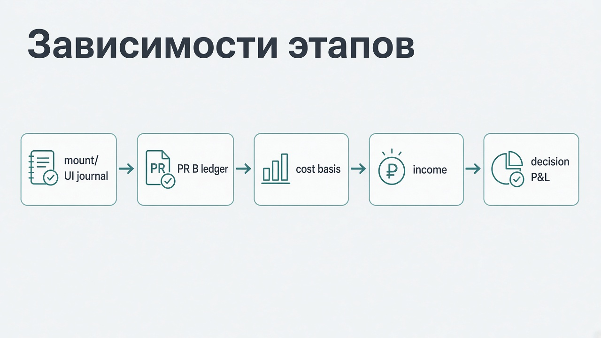

# План текущего этапа

## Визуальный ориентир

*Сначала journal/mount, потом ledger. Иллюстрация Vault.*

**Текущий этап не запущен.** Master Context на 2026-11-23 говорит: владелец смотрит roadmap и выбирает волну. Пока выбора нет, «делать всё Gate 0–4» нельзя. Ниже — предлагаемая первая волна, совпадающая с критическим путём. Карточка спринта: [[Спринт Gate 0 — инвесторский baseline]].

## Зачем эта волна первая

Инвестор не отличит верный P&L от ошибки, если экран показывает старый frontend, а форма покупки пишет в журнал другие штуки, чем показала в превью. Красивый календарь дивидендов на такой базе ускорит недоверие.

## Что входит, если владелец подтвердит

1. Инвентаризация того, кто слушает порт кабинета и какой каталог примонтирован. Исправление только frontend-привязки, без смены портов, томов и чужих грязных worktree.
2. Проход основных экранов инвестора на широком и узком окне, свет и тьма. Список конкретных поломок, а не общее «поправить UX».
3. Демо-портфель на тестовых данных: внесение денег, покупка, продажа, дивиденд; обновление страницы не теряет операции. Реальную книгу владельца для этого не трогать.
4. PR B как отдельный маленький PR после отдельного разрешения: лоты и штуки, дата операции, чистая форма, идемпотентность против смены тарифа. Без переписывания уже лежащих в базе пользовательских строк.
5. Короткая приёмка: человек без контекста понимает оценку и не видит `FILLED` на первом экране.

## Что не входит

- расчёт P&L решения;
- Dataset V5 и любые новые модели;
- дивидендный провайдер «наконец включить»;
- PR C, если он не нужен для конкретного бага экрана этой волны (он остаётся следующим плановым объёмом, P2);
- сеть, авторизация, брокер;
- merge #100/#101 без явного «можно сливать».

## Как поймём, что волна кончилась

Есть SHA, на котором смотрели браузер. Есть запись, какой mount это был. Демо-операции сходятся до и после перезагрузки. Противоречивые лоты не сохраняются (если PR B вошёл в волну). Владелец отдельно говорит, принят ли вид. Зелёный CI не заменяет эту фразу.

До этой фразы статус волны в Vault: **proposed**.
