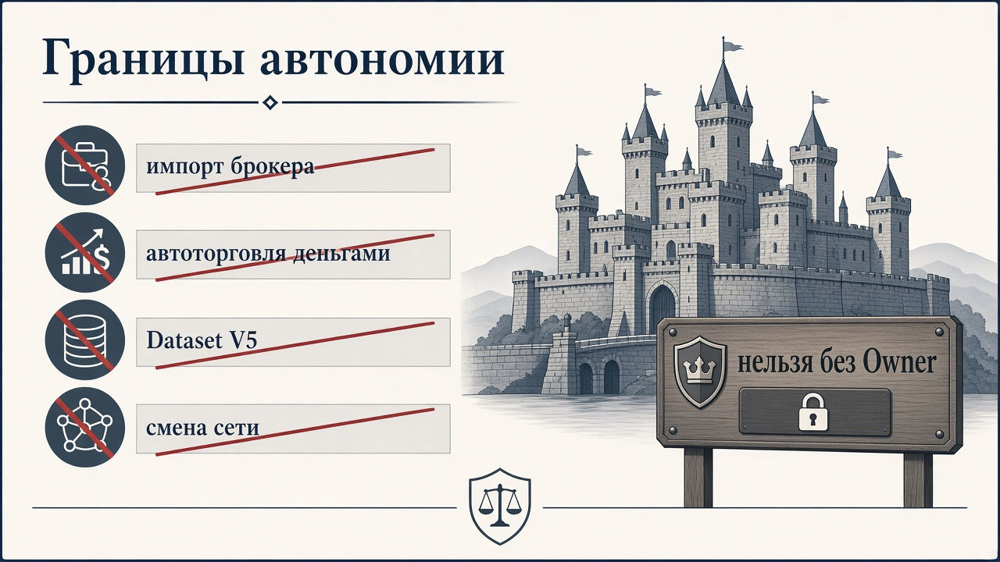

# Автономность и ограничения

## Визуальный ориентир

*Что нельзя без Owner. Иллюстрация Vault; не скриншот приёмки и не доказательство runtime.*

Автономность в Kraken — последняя ступень, а не режим по умолчанию. Документы описывают лестницу:

исторический симулятор → walk-forward → Shadow / бумага → сигналы человеку → исполнение, которое человек подтвердил → малый реальный капитал → ограниченная автономия.

На 2026-11-23 проект стоит на ручном личном учёте, бумаге и исследованиях. Заявок брокеру нет. Включать «немного автономии» внутри другой задачи нельзя: это отдельный архитектурный и охранный этап.

## Что закрыто, пока владелец не откроет заново

| Тема | Почему закрыто |
|---|---|
| Импорт брокерских отчётов и синхронизация счёта | решение 2026-11-19: ручной учёт первичен; импорт под другим именем тоже запрещён |
| Торговый API брокера | исполнение реальных заявок не заработано лестницей выше |
| Автономная торговля реальными деньгами | нет проспективного доказательства экономики |
| Dataset V5 и тихая смена production Candidate | смена смысла данных требует явной версии и задачи; кампания V4 повышение не обосновала |
| Порты, firewall, привязки сети, охват Redis и Postgres | прямое исключение 2026-10-28, включая PR B и PR C |
| Массовый backfill и переписывание истории | риск затереть сырые факты и LIVE-след; догон Shadow не запускают «широкой лопатой» из UX-задачи |

Рыночные данные с публичного или отдельно разрешённого read-only источника — не то же самое, что доступ к счёту. Даже их подключение оценивается отдельно, с лицензией и происхождением.

## Какие ограничения остаются даже в мечте

- в момент `t` нет будущего;
- сырая сделка на бирже не затирается;
- неизвестная цена, комиссия и рейтинг не становятся нулём;
- прогноз не равен приказу;
- язык модели не равен числу;
- чужой грязный worktree и тома Docker не чистятся «для удобства»;
- USER/OWNER не считаются защитой, пока нет настоящего разграничения доступа.

## Кто имеет право сдвинуть границу

Только явная задача владельца. Упоминание брокера в схеме future-intelligence roadmap — напоминание, что адаптер когда-нибудь сменяемый, а не заказ писать адаптер. Упоминание ограниченной автономии — конец лестницы, не ближайшая ступень.
