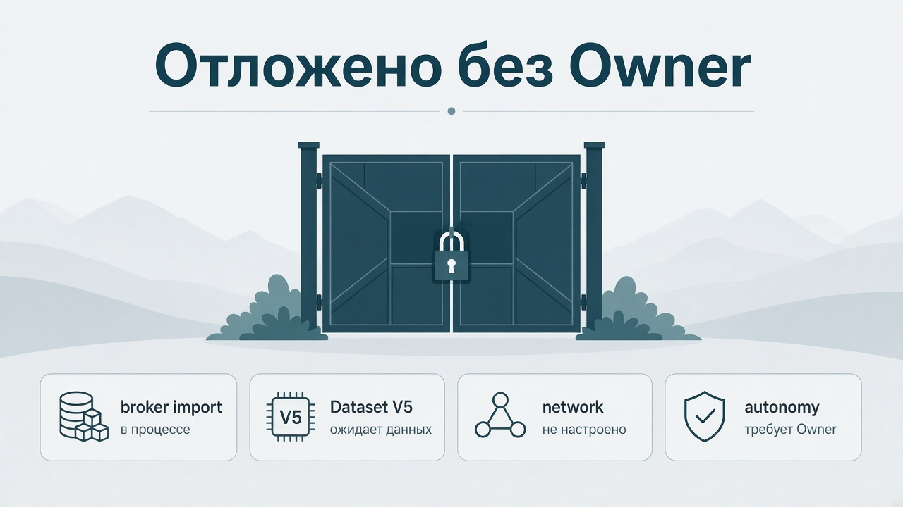

# Возможные модули

## Визуальный ориентир

*Идеи ≠ разрешение на реализацию. Иллюстрация Vault.*

На `origin/main` уже есть пакеты в `backend/app/modules`: analytics, fundamentals, historical, intelligence, investment, learning, market, market_history, memory, model_edge, news, portfolio, prediction, recommendations, relations, research_cycle, research_evidence, research_lab, risk, shadow, simulator, system, technical, workflows.

Наличие каталога не значит, что модуль закончен или что его можно включать в личный совет. Ниже — роли, которые архитектура хочет сохранить раздельными. Новые продукты (Kafka, отдельная колоночная база, шина событий) этим списком не предлагаются.

| Роль | Зачем отдельная | Зрелость на main |
|---|---|---|
| Рынок и справочник | сырые факты и каталог шире исследовательской вселенной | рабочий контур MOEX EOD, догон |
| Корпоративные действия | события, не заплатки свечей | контракт принят; дивидендный провайдер не READY |
| Фундаментал | отчёт с датой публикации | промышленный FNS есть; банки — честный пробел |
| Новости и макро | происхождение и время наблюдения | контур 1.05; исторический OOS новостей не заявлен |
| Прогноз | оценка будущего, не приказ | Candidate на Dataset V2 |
| Мета-доверие | насколько прогнозу верить | направление, не чемпионский прод |
| Политика | предложение действия | частично в Shadow / Daily Decision |
| Риск | урезать или запретить | сценарии как стресс, не автоисполнение |
| Исполнение | провести намерение | Shadow и симулятор; брокер запрещён |
| Личный журнал | деньги человека | есть, целостность PR B ещё план |
| Shadow | бумага | есть, приёмка догона не равна merge |
| Память решений | неизменяемый снимок | отдельная БД; не замена датасету |
| Evidence | сравнение кандидатов | кампания 1.04 завершена как research |

## Что может появиться позже

Только как исследование, пока владелец не назовёт этап:

- более глубокая история режимов рынка;
- банковский фундаментал от принятого источника;
- опциональный рыночный провайдер без доступа к счёту;
- пользовательские неликвидные активы с отдельной методикой оценки;
- календарь дохода как продукт Gate 2.

## Что не является «возможным модулем»

Импорт брокера, автономный торговый агент, Dataset V5, смена сети, массовая перезаливка истории. Это не идеи на полке, а запреты. См. [[Отложенные идеи]].
