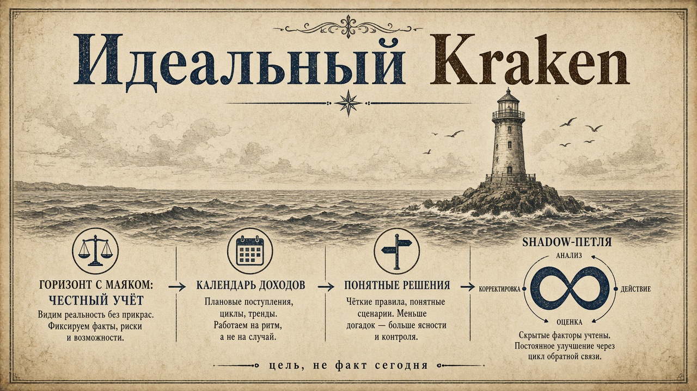

# Идеальный Kraken

## Визуальный ориентир

*Целевой образ продукта. Иллюстрация Vault; не скриншот приёмки.*

Идеальный Kraken в документах — самообучающаяся инвестиционная система, которая **сначала** доказывает себя на истории и в бумаге, и только потом получает право на реальное исполнение. Это имя зрелого состояния, не пакет в репозитории.

Картинка целевого контура (её нельзя принимать за список уже написанных модулей):

рынок → аналитика → связи → технический и фундаментальный взгляд → датасет на момент времени → прогноз → мета-оценка доверия → политика → риск → намерение ордера → сменяемый исполнитель (симулятор, бумага или, гораздо позже, брокер) → исход → обучение → память решения.

Рядом живёт быт инвестора, без которого «идеальный мозг» не нужен: ручной журнал, честные деньги, календарь дохода, сравнение с ориентиром, совет на русском. Идеал без бухгалтерии — витрина. Бухгалтерия без честного отказа от неизвестного — красивая таблица, которая врёт.

## Как выглядит удачный день в этом образе

Утром инвестор видит свой NAV и пометку, полный он или нет. Календарь показывает дивиденд, у которого есть источник, и отдельно — выплату, сумма которой ещё неизвестна. Совет говорит, что изменилось со вчера, и какую неопределённость система не скрывает. Если человек согласен, он сам записывает сделку. Shadow параллельно живёт своей книгой и не улучшает личную доходность задним числом. Исследовательский прогон ночью либо остаётся кандидатом, либо, после сравнения, становится чемпионом — записью, а не ощущением чата.

## Чем идеал не является

- робот, который «сам торгует лучше рынка» без проспективного следа;
- одна цифра точности;
- импорт брокерского отчёта как фундамент;
- переписывание свечей так, чтобы график выглядел гладким;
- LLM, который придумывает суммы и даты.

Путь к исполнению из future-intelligence roadmap остаётся концептуальным: симулятор, walk-forward, Shadow, сигналы, подтверждение человеком, малый капитал, ограниченная автономия. Последние ступени сегодня **запрещены**. См. [[Автономность и ограничения]] и [[Сценарии роста]].
