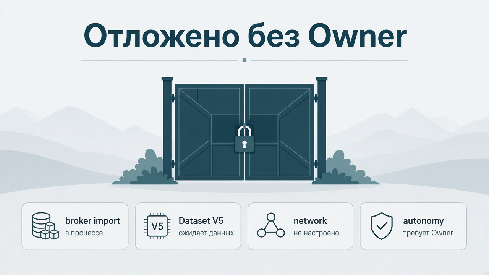

# Отложенные идеи

## Визуальный ориентир

*Без явного Owner — не стартовать. Иллюстрация Vault.*

Четыре ярлыка, и они не синонимы:

| Ярлык | Смысл |
|---|---|
| confirmed | владелец уже так решил; исполнение может быть ещё впереди |
| proposal | предложенный объём работы, кода нет и старт не разрешён |
| research | направление или уже закрытый исследовательский факт, не заказ на прод |
| forbidden | нельзя делать без нового явного разрешения владельца |

## Запрещено без нового слова владельца

| Идея | Ярлык | Опора |
|---|---|---|
| Импорт брокерских отчётов, синхронизация позиций и сделок, обход запрета через «чужой CSV» | forbidden | решение 2026-11-19 |
| Торговый API брокера и отправка заявок | forbidden | тот же запрет и лестница реальных денег |
| Автономная торговля реальными деньгами | forbidden | AI workflow, протокол, Current State |
| Dataset V5 и смена production Candidate «по пути» | forbidden | Current State 07.10.2026, не отозвано позже |
| Смена портов, firewall, сетевых привязок, доступности Postgres/Redis | forbidden | исключение 2026-10-28 |
| Массовый backfill, широкий догон, переписывание исторического журнала ради UX | forbidden | ревью журнала 2026-10-30: не переписывать ledger и не запускать широкий catch-up |

## Предложено, но не начато

| Идея | Ярлык |
|---|---|
| Gate 0: кабинет и проверка mount | proposal |
| PR B: лоты, дата, идемпотентность комиссии | proposal |
| PR C: поздние ответы интерфейса не затирают текущий экран | proposal |
| Gate 1: себестоимость, раздельный P&L, XIRR | proposal |
| Gate 2: календарь дивидендов и купонов | proposal |
| Gate 3: бенчмарк, ребаланс-предложение, цели | proposal |
| P&L, отнесённый к решению, отдельным read-model | proposal |
| Журнал V4.1 (#100/#101) как приёмка вида | proposal, PR открыты на снимке, merge не разрешён |
| Выгрузка собственных записей Kraken | proposal |
| Пользовательские активы, другие рынки, сообщество | proposal, только если их попросят, Gate 5 |

## Исследование и направление

| Идея | Ярлык |
|---|---|
| Future intelligence roadmap целиком как «достроить мозг» | research |
| Живой LLM и извлечение событий | research |
| Банковский фундаментальный провайдер | research |
| Более глубокая честная 60-минутная история | research |
| Оценка пакетов признаков intelligence на новом окне | research |
| Режимы рынка как исследовательская тема | research |
| Каноническая кампания V4 уже сделана; её вывод «нет прироста над BASE» | research, факт, не план переделки |
| Открытый PR #58 про дивидендный PIT | research, не сливать без задачи |
| Read-only рыночное обогащение без счёта | research, отдельная правовая оценка |

## Уже решено и не является отложенной фантазией

Ручной учёт первичен; отсутствующее не ноль; прогноз не сделка; Vault локальный; проверки соразмерны риску; USER/OWNER — витрина. Ярлык этих пунктов — **confirmed**. Они повторены в [[Идеи владельца]], чтобы отложенный список не выглядел как сомнение в них.

Агент, который «просто реализует верхнюю строку», нарушает ярлык. Верхние строки как раз трогать нельзя.
