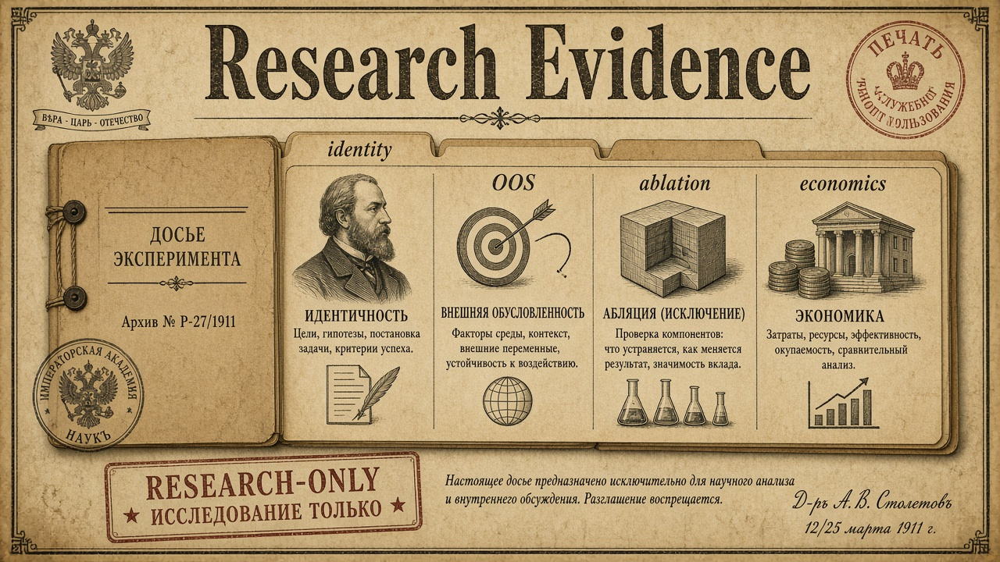

# Research выдан за production

## Визуальный ориентир

*Не смешивать среды. Иллюстрация Vault; не скриншот приёмки.*

## Как выглядит

В личном совете появляются идеи с датасета, который ещё сравнивают. В разговоре «кампания завершена» звучит как «модель победила и включена». Отрицательный IC прячут, положительный кусок окна оставляют.

## Почему это случается

Каталоги `research_*` лежат рядом с портфелем в одном монолите. Общая база легко позволяет прочитать не ту таблицу. Статус COMPLETE у прогона означает «досье собрано», не «чемпион назначен».

На main как раз есть соблазнительный факт: V3 и V4 посчитаны, PIT прошёл, образцы есть. И рядом второй факт: прироста над базой нет, Candidate остаётся на V2. Второй факт обязателен в той же фразе, что и первый.

## Как должно быть

Исследовательский сигнал не попадает в точный план покупок. Сравнение не меняет активную спецификацию. Повышение — отдельная запись. Досье с другой границей окна хранится как аудит, не подменяет каноническое.

## Мини-проверка

Спросите, какой `dataset_spec` у совета на экране. Если ответ «последний успешный run» — это антипаттерн. См. [[Candidate vs Champion]] и [[Research Evidence Engine]].
