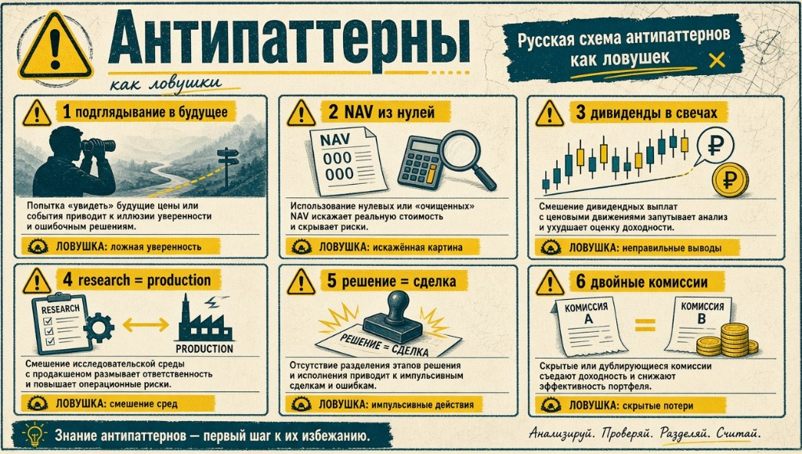

# Индекс антипаттернов

## Визуальный ориентир

*Типовые ловушки проекта. Иллюстрация Vault; не скриншот приёмки и не доказательство runtime.*

Это учебные ловушки: как легко получить красивую и неверную цифру. Операционные карточки багов живут в каталоге проблем. Здесь — чтобы человек узнал ошибку в следующий раз до того, как она попадёт в отчёт.

| Заметка | Одной фразой |
|---|---|
| [[Look-ahead в обучении и решениях]] | будущее уже сидело в прошлом |
| [[Плохой NAV]] | стоимость портфеля назвали полной или прибылью |
| [[Дивиденды, зашитые в свечи]] | цену починили так, что событие исчезло |
| [[Research выдан за production]] | лабораторный прогон стал «боевой моделью» без повышения |
| [[Решение принято за сделку]] | совет, ордер и исполнение склеили |
| [[Двойной учёт комиссий]] | одну плату списали дважды |
| [[Устаревший Docker mount]] | браузер показывает не тот каталог, который только что починили |
| [[Фейковый ноль]] | неизвестность записали числом 0 |

Общие термины: [[Point-in-Time (PIT)]], [[Missing price ≠ zero]], [[Evidence level]].
