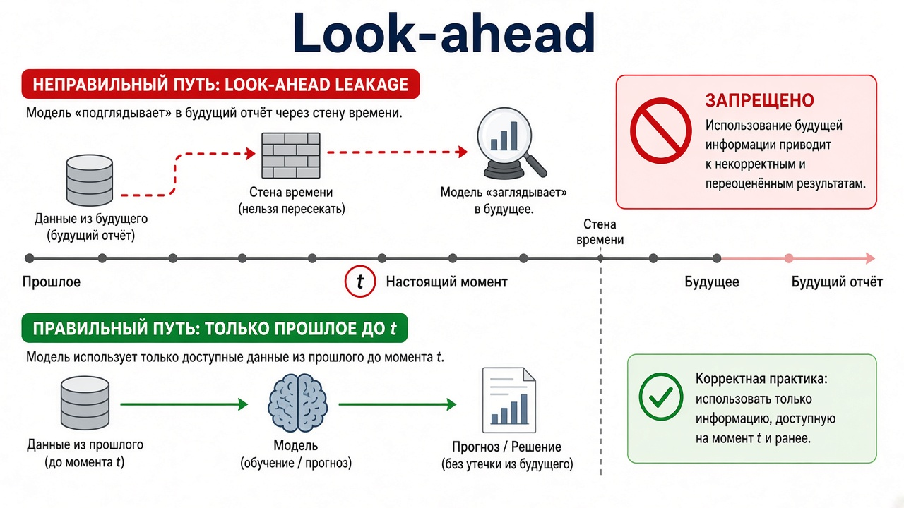

# Подглядывание в будущее

## Визуальный ориентир

*Нельзя подглядывать в будущее. Иллюстрация Vault.*

Каноническая заметка: [[Look-ahead в обучении и решениях]].  
См. также термин [[Look-ahead leakage]] · [[Point-in-Time (PIT)]].
