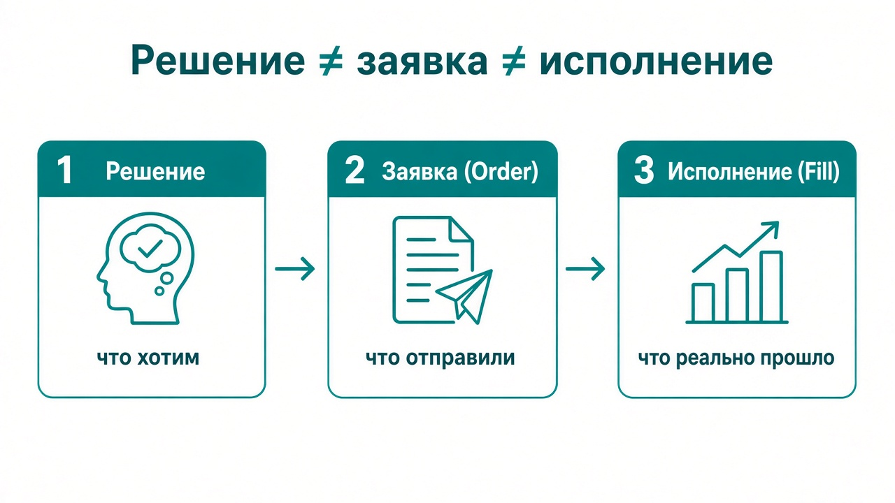

# Решение принято за сделку

## Визуальный ориентир

*Решение, заявка и fill — разные вещи. Иллюстрация Vault.*

## Как выглядит

Экран говорит «куплено», хотя человек только прочитал совет. Или в день сигнала уже нарисован P&L исполнения, которое прошло через два дня. Или совпадение даты рекомендации и даты ручной покупки автоматически стало причинностью.

## Почему так выходит

В коде рядом лежат decision, order и fill. Для инженера это одна сага. Для инвестора «решение» звучит как действие. Журнал, который группирует исполнения по дате fill, ещё и показывает ноль исполнений в день сигнала — и хочется «починить» это, приписав fill к дню решения. Это уже порча времени.

Кнопка фиксации совета пишет память и по контракту 1.03 не трогает журнал денег. Если после неё изменился кэш, сломана граница.

## Как должно быть

Три строки, три даты, если они различаются. Пример, который нельзя склеивать: сигнал 2026-09-03, решение 2026-09-07, fill 2026-09-08. Нет сопоставления — нет P&L этой цепочки. Связь с личной операцией появляется после явного подтверждения и помечается честно, не как доказанный мотив.

## Мини-проверка

Зафиксируйте совет на тестовом портфеле и обновите страницу. Позиции и кэш те же. См. [[Decision vs Order vs Fill]].
