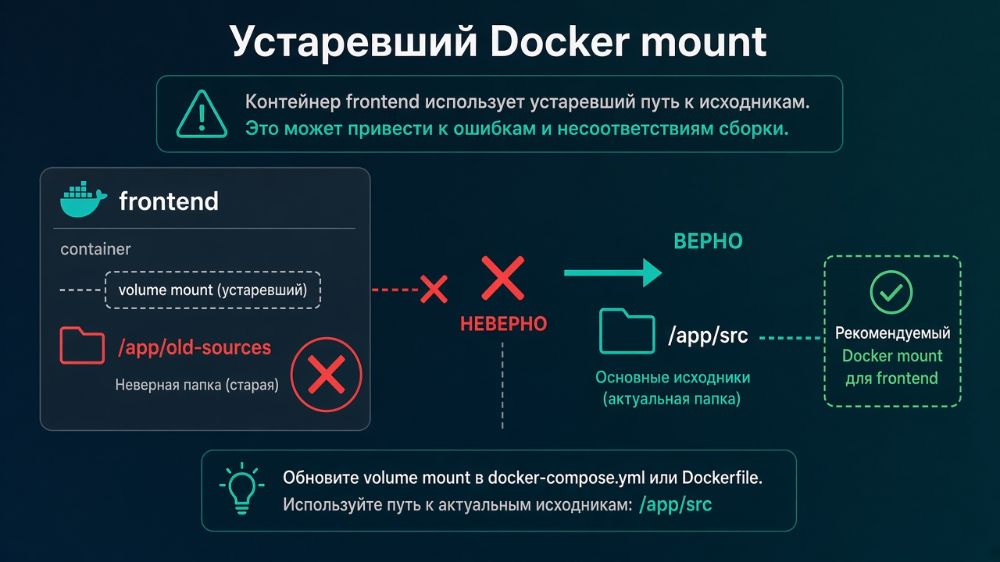

# Устаревший Docker mount

## Визуальный ориентир

*Контейнер может смотреть не на main. Иллюстрация Vault.*

## Как выглядит

В git уже есть кнопка «Детали решения» и блок общей стоимости. В браузере их нет. Кажется, что merge потерялся или кэш «просто вредничает».

## Что произошло 2026-10-30

Владелец прислал скриншоты `/shadow` и `/portfolio` после merge #98 и #99. GitHub на тот момент показывал код с этими элементами в main `95f2fd85…`. Compose монтирует `./frontend/src` внутрь контейнера относительно каталога, откуда поднимали стек. Если стек поднимали из старого worktree, контейнер честно показывает старый исходник. Это гипотеза, записанная в Master Context. Сам `docker inspect` в момент скриншотов независимо не приложен.

## Как путают с другими поломками

Жёсткое обновление страницы не меняет файл на диске контейнера. Пересборка backend не меняет frontend mount. Снос томов стирает данные и не объясняет, какой каталог был примонтирован. Смена порта запрещена отдельным решением и к этой болезни не относится.

## Как должно быть

Перед приёмкой UI называют четыре вещи: кто слушает порт кабинета, какой путь примонтирован, какая ветка, какой HEAD. Меняют привязку frontend, не весь стек. После вливания в main runtime по возможности возвращают на актуальный main, чтобы следующий день не начинался со старой ветки.

Пока эти четыре вещи не записаны, скриншот не доказывает ни баг продукта, ни его отсутствие. См. [[Docker-first]] и [[Git и worktrees]].
