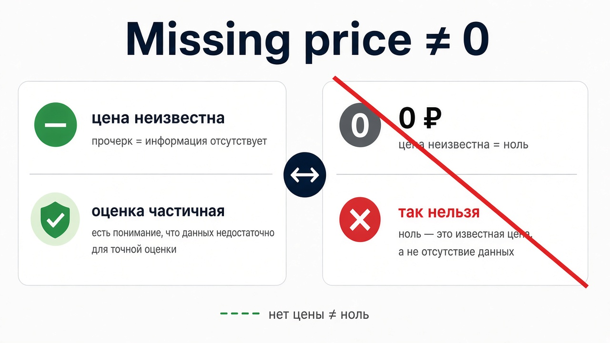

# Фейковый ноль

## Визуальный ориентир

*Нет цены не равно 0. Иллюстрация Vault.*

## Как выглядит

В интерфейсе ровная сетка чисел. Дыр нет. На деле часть дыр заменили нулём: бумага без цены стоит 0 ₽, неизвестный тариф берёт 0, воздержавшийся комитет «нейтрален», пропущенный P&L решения равен 0 ₽, оборванный запрос каталога выглядит как честное «пусто».

## Почему ноль опаснее прочерка

Ноль участвует в сумме, в проценте, в сравнении с кэшем и в обучении. Прочерк останавливает формулу. После суммирования уже не видно, где была дыра: итог выглядит полным.

Отдельный подвид — накладка в браузере, которая рисует частичность поверх нормального ответа. Она прячет дыру противоположным способом: учит команду верить скриншоту, который backend не присылал. Ревью PR #91 отдельно отметило, что такой скриншот не доказательство частичных данных.

## Как должно быть

Неизвестность — состояние: PARTIAL, UNAVAILABLE, UNKNOWN, ABSTAIN, NOT_AVAILABLE. Нейтральный сигнал возможен только когда данные были и сказали «без перекоса». Комиссия неизвестна — сделку не считают бесплатной. Цена неизвестна — позицию не оценивают нулём и не выкидывают из полного NAV молча.

## Мини-проверка

Уберите цену одной бумаги в фикстуре. Итог должен перестать называться полным. Если итог уменьшился ровно на прежнюю стоимость и остался «полным» — ноль занял место цены. См. [[Missing price ≠ zero]].
