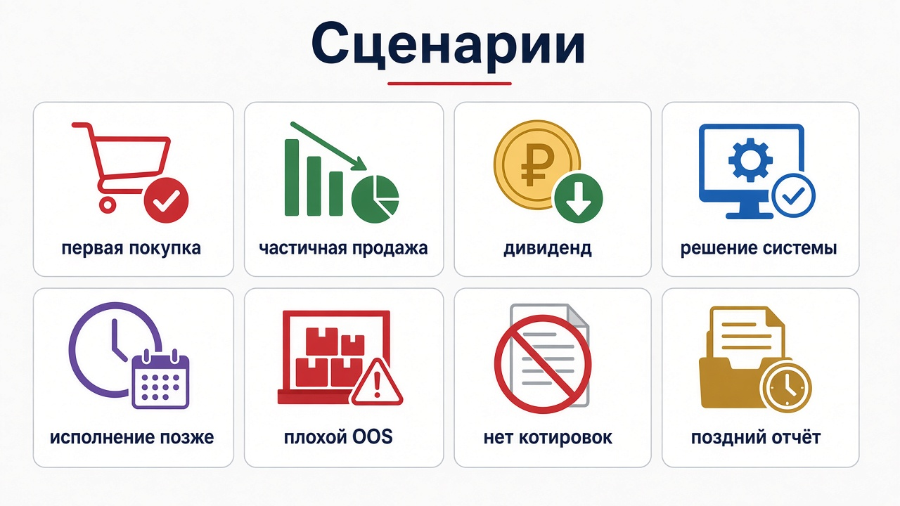

# Индекс сценариев

## Визуальный ориентир

*Сюжеты для погружения. Иллюстрация Vault; не скриншот приёмки и не доказательство runtime.*

Восемь путей, по которым проверяют, что Kraken говорит правду. Цифры в сценариях учебные, не выгрузка живого счёта. Где шаг ещё не является готовой кнопкой, это написано в самом сценарии.

Обзор без шагов: [[Пользовательские сценарии]].

| # | Сценарий | Что защищает |
|---|---|---|
| 1 | [[Сценарий — журнал от взноса до частичной продажи]] | одна цепочка ручного учёта |
| 2 | [[Сценарий — взнос не является прибылью]] | капитал отдельно от результата |
| 3 | [[Сценарий — нет цены, оценка частичная]] | дыра не становится нулём |
| 4 | [[Сценарий — совет не двигает деньги]] | решение не сделка |
| 5 | [[Сценарий — три даты одного следа]] | сигнал, решение и исполнение |
| 6 | [[Сценарий — два личных портфеля]] | книги не смешиваются |
| 7 | [[Сценарий — Shadow не берёт сегодняшний open]] | нет look-ahead в бумаге |
| 8 | [[Сценарий — кампания не становится чемпионом]] | research не прод |

Для приёмки используют тестовый портфель. Живую книгу владельца этими упражнениями не изменяют.
