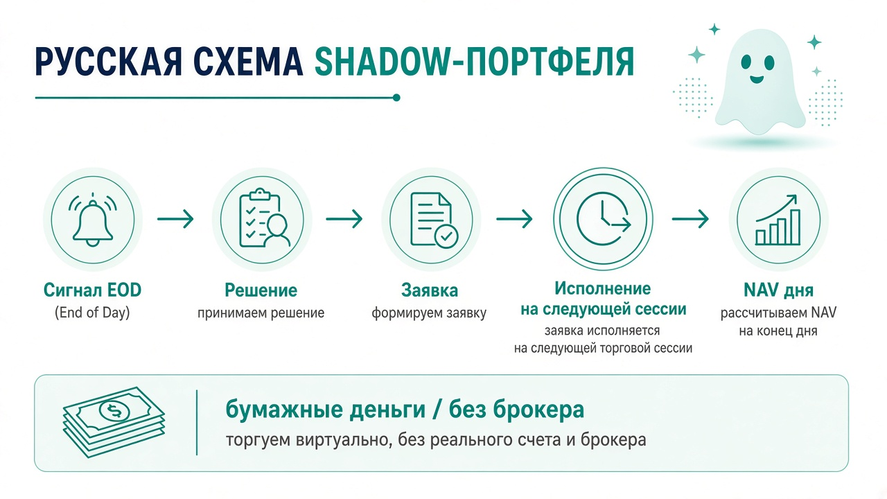

# Сценарий — Shadow не берёт сегодняшний open

## Визуальный ориентир

*Исполнение не подглядывает open дня сигнала. Иллюстрация Vault; не скриншот приёмки.*

## Зачем

Поймать look-ahead в бумажном исполнении. Правило ADR 0009: ордер, созданный после открытия текущей сессии, ждёт следующую. Сегодняшнее открытие для него уже прошло.

## Шаги

1. Зафиксировать, какой контейнер отдаёт кабинет и какой каталог примонтирован. Иначе сценарий проверяет старый код.
2. Взять учебный Shadow, не историю владельца, которую нельзя переписывать.
3. В середине уже открытой сессии создать новый эксперимент или новый ордер. Ожидание: сегодня исполнений нет. Причина объяснена человеческим языком, не только внутренним кодом «минимальная дата не наступила».
4. Дождаться следующей сессии или прогнать заранее оговорённый тестовый календарь, если он есть в фикстуре. Исполнение берёт официальное открытие той следующей сессии, не последнюю сделку.
5. Повторить догон. Вторая пачка тех же исполнений не появляется.
6. Убедиться, что внутридневная котировка, если она включена, не записалась в сырые дневные свечи как будто это исторический факт обучения.

## Провал

Fill по открытию того же дня, когда ордер создан после открытия. Догон вчерашнего плана, который покупает по уже прошедшему сегодняшнему open. Дубликаты после повторного запуска. Пометка LIVE на пересчёте, который сделали сегодня.

См. [[Shadow portfolio]] и [[Устаревший Docker mount]].
