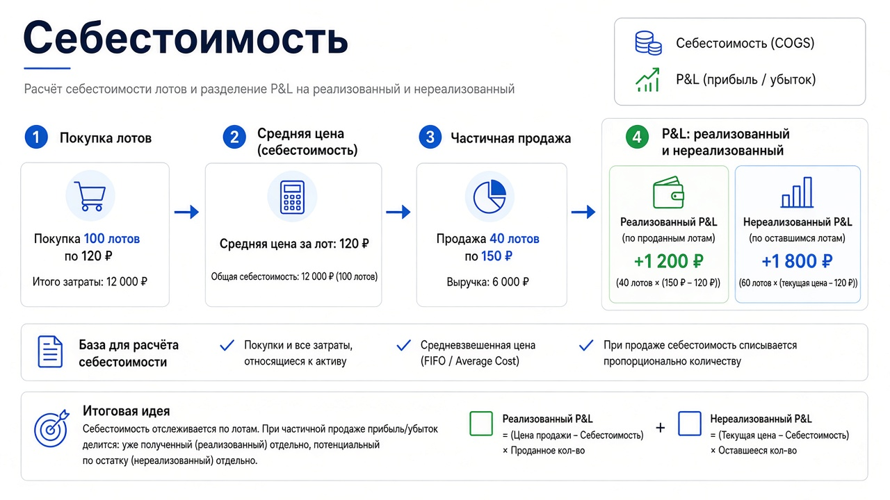

# Сценарий — взнос не является прибылью

## Визуальный ориентир

*Депозит не считать доходностью. Иллюстрация Vault; не скриншот приёмки.*

## Зачем

Отличить «в портфель пришли новые деньги» от «портфель заработал». Формула модели: инвестиционный результат = NAV − (внесено − выведено).

## Шаги

1. Тестовый портфель. Внести 50 000 ₽. Бумаг нет. NAV = кэш = 50 000. Результат 0.
2. Ничего не покупать. На следующий день снова внести 50 000 ₽. NAV 100 000. Результат всё ещё 0.
3. Вывести 10 000 ₽. NAV 90 000. Внесено 100 000, выведено 10 000, чистый капитал 90 000. Результат 0.
4. Купить бумаги так, чтобы остался кэш, и задать рыночную цену выше покупки. Результат становится положительным на рыночную разницу за вычетом комиссии, а не на всю сумму NAV.
5. Внести ещё 1 000 ₽. NAV вырастет на 1 000. Инвестиционный результат не вырастет на 1 000.

## Если цены нет

NAV может стать частичным или недоступным. Тогда и результат помечают неизвестным, а не оставляют вчерашнюю прибыль рядом с сегодняшней дырой как будто ничего не случилось.

## Провал

Любой экран, где второй взнос увеличил «доход» или «доходность». Процент, посчитанный как прибыль / NAV без учёта дат взносов, — ещё не XIRR; его не подписывают годовыми.
