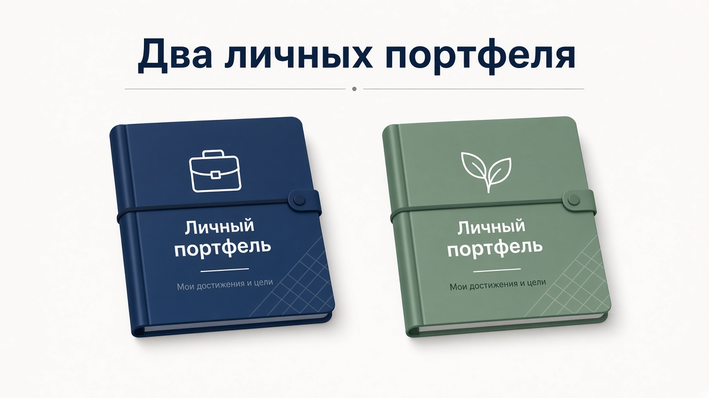

# Сценарий — два личных портфеля

## Визуальный ориентир

*Книги раздельно, Shadow не смешивать. Иллюстрация Vault.*

## Зачем

Проверить изоляцию модели V2: два учёта, два кэша, никакого общего «основного» одиночки, который V2 отменила.

## Шаги

1. Создать тестовые портфели «Учебный А» и «Учебный Б».
2. В А внести 10 000 ₽. В Б не вносить ничего. Переключиться на обзор Б: кэш Б пуст, деньги А не видны.
3. Купить бумагу только в А. Позиция не появляется в Б.
4. Сбросить или очистить только тот портфель, который всё ещё черновик, либо сбросить А, если сознательно проверяете разрушительное действие на копии. Б остаётся прежним. Удаление А не удаляет Б.
5. Открыть Shadow, если он есть в том же приложении. Его стоимость не прибавляется к А и не к Б в строке личных денег.
6. Совет дня в А и в Б может различаться. Выбор портфеля в переключателе — тот, для которого считается экран.

## Провал

Общий кэш. Позиция протекла. Сброс одного очистил оба. Shadow попал в «мои портфели» как будто это личные рубли. Интерфейс снова предлагает единственный неудаляемый `/primary`.

Живой портфель владельца в шаге 4 не используют.
