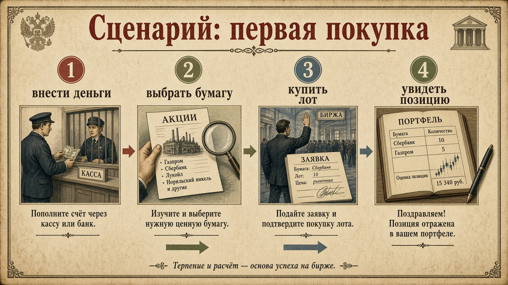

# Сценарий — журнал от взноса до частичной продажи

## Визуальный ориентир

*Базовый путь ручного учёта. Иллюстрация Vault; не скриншот приёмки.*

## Зачем

Проверить, что ручная цепочка сходится: деньги пришли, бумага куплена, дивиденд получен, часть продана, комиссия одна, остаток объясним. Это эталон из Gate 1. Пока PR B не сделан, расхождение превью и журнала в этом сценарии — найденный дефект, не «так и задумано».

## Условия

Тестовый личный портфель, не живой. Рынок не обязателен, если цену сделки вводят руками. Одна бумага, лот 10 штук.

## Шаги

1. Создать портфель в черновике и начать учёт, когда появится первая операция. Пустой активный журнал допустим, если так устроен экран: важно, чтобы дальше остатки шли из операций.
2. Внести 100 000 ₽. Кэш 100 000. Инвестиционный результат 0, потому что NAV вырос на тот же вклад.
3. Купить 20 штук (2 лота) по 1 000 ₽. Комиссия 30 ₽ один раз. Кэш 100 000 − 20 000 − 30 = 79 970 ₽. Себестоимость позиции 20 030 ₽.
4. Записать дивиденд 500 ₽, если операция дохода уже есть в форме. Кэш 80 470 ₽. Себестоимость акций от дивиденда не уменьшается: это доход, не удешевление покупки. Если отдельной операции дивиденда на экране нет, шаг помечают «в продукте ещё нет» и не изображают дивиденд правкой кэша мышкой.
5. Продать 10 штук по 1 100 ₽, комиссия продажи 20 ₽ один раз. Списывается половина себестоимости, 10 015 ₽. Выручка на кэш: 11 000 − 20 = 10 980 ₽. Реализованный результат: 11 000 − 20 − 10 015 = 965 ₽. Остаток 10 штук с себестоимостью 10 015 ₽.
6. Обновить страницу и перезапустить только если проверяете живучесть. Операций должно остаться столько же, без второй комиссии.

## Что считать провалом

Превью посчитало 10 штук, журнал записал 20. Комиссия и в цене, и отдельной строкой. После F5 пропала продажа. Дивиденд уменьшил себестоимость и одновременно пришёл как доход.

## Чего сценарий не обещает

Готовую XIRR и налог. Их отсутствие помечают, не закрывают нулём.
