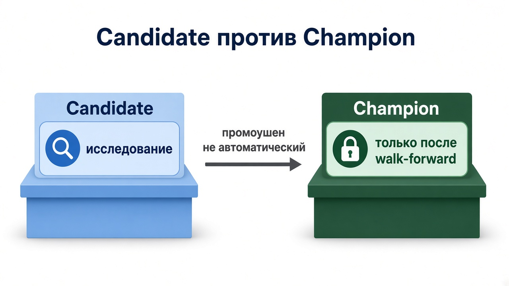

# Сценарий — кампания не становится чемпионом

## Визуальный ориентир

*Research не промоутится сам. Иллюстрация Vault; не скриншот приёмки.*

## Зачем

Прочитать evidence так, чтобы завершённый прогон не превратился в смену боевой модели.

## Шаги

1. Открыть описание выпуска 1.04 в «О Kraken» или заметку [[Research Evidence Engine]]. Найти канонический отпечаток досье `fe5609a2ced6082992d923bc57cf99655d73e2787c119564de42bc48803bf233`.
2. Рядом прочитать, что более ранний полный прогон сохранён как аудит из-за другой границы окна. Его не называют каноническим.
3. Сравнить формулировку с числами окна: база по среднему rank IC выше полного V4 на том прогоне. Фразу «фундаментал включён в прод» из этого сделать нельзя.
4. Проверить личный совет или подпись кандидата: спецификация боевого кандидата остаётся V2. Признаки V3/V4 не становятся планом покупок.
5. Не запускать новую кампанию и не создавать Dataset V5 в ходе этого сценария. Сценарий читает, а не ставит эксперимент.

## Провал

Канонический отпечаток подменён аудитом. В интерфейсе инвестора исследовательский сигнал подан как уже действующий чемпион. Отрицательное сравнение спрятано, оставлен только успешный статус прогона. Кто-то «починил» результат новой версией датасета без задачи владельца.

См. [[Candidate vs Champion]] и [[Research выдан за production]].
