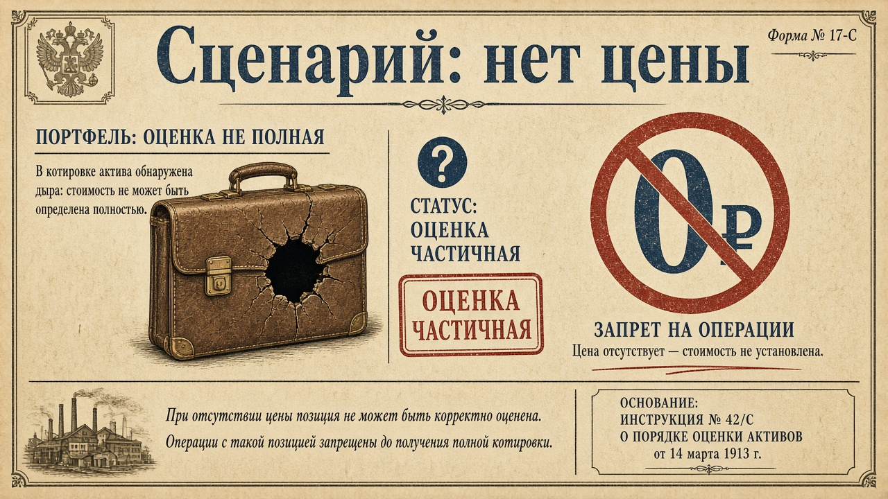

# Сценарий — нет цены, оценка частичная

## Визуальный ориентир

*Частичная оценка, не ноль. Иллюстрация Vault; не скриншот приёмки.*

## Зачем

Увидеть PARTIAL вместо фейкового нуля. Это поведение Hub после PR #91 и правило протокола.

## Шаги

1. Тестовый портфель: кэш 10 000 ₽, бумага А на 4 000 ₽ по известной цене, бумага Б без цены.
2. Открыть список портфелей и карточку. Ожидание: известная часть 14 000 ₽ и явная неполнота. Нет фразы, что весь портфель стоит 14 000 ₽ без оговорки. Нет оценки Б как 0 ₽ внутри полного итога.
3. Открыть P&L. Если у Б нет и себестоимости, строка результата по ней пустая, даже когда позже цена появится только у рыночной стоимости. Пустая себестоимость не обязана прятать NAV целиком.
4. Вернуть цену Б. Итог может стать полным. Доходность за период, внутри которого был дырявый день, либо объясняет дыру, либо не строится.

## Провал

Просадка 100% по Б. Полный NAV, в котором Б исчезла. Кэш показан как вся стоимость, пока бумаги существуют. Скриншот с нарисованной поверх страницы плашкой «частично» без такого ответа сервера — не прохождение сценария.

См. [[NAV и Partial NAV]] и [[Фейковый ноль]].
