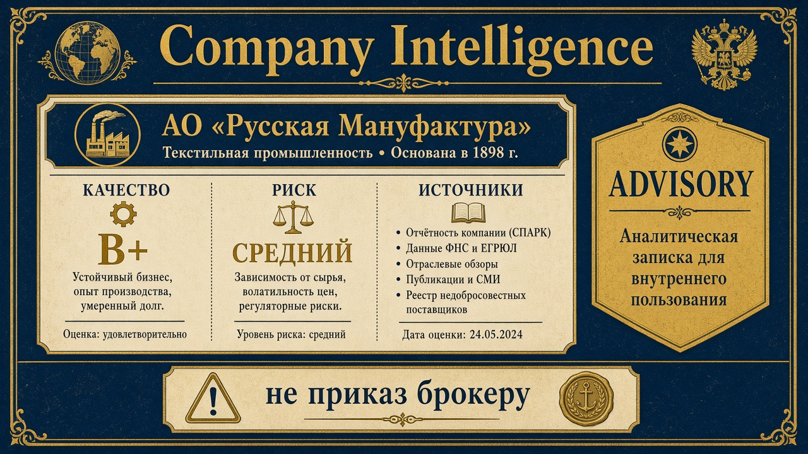

# Сценарий — совет не двигает деньги

## Визуальный ориентир

*Рекомендация не двигает брокер. Иллюстрация Vault; не скриншот приёмки.*

## Зачем

Проверить границу Daily Decision и личного журнала, как она описана в выпуске 1.03.

## Шаги

1. Взять тестовый активный портфель с известным кэшем и одной позицией. Записать числа.
2. Открыть совет дня. Прочитать, что система предлагает рассмотреть. Не нажимать ничего, что похоже на запись операции.
3. Если есть действие «зафиксировать решение», нажать его один раз. Обновить страницу.
4. Сверить кэш, количество бумаг и список операций с шагом 1. Они те же.
5. Открыть память решения. Там снимок того совета, который был на экране, а не новый пересчёт, если данные уже уехали. Горизонты наблюдения 5, 20 и 60 сессий относятся к цене. Подпись, что дивиденды в это наблюдение не входят, должна быть заметна, если экран следует тексту 1.03.
6. Вручную добавить покупку. Связь с советом, если она предлагается, остаётся возможной, пока человек её не подтвердит. После отказа подтвердить покупка живёт в журнале, совет — в памяти, стрелки причинности нет.

## Провал

Кэш изменился от фиксации. Появилась операция без формы сделки. Текст совета говорит «исполнено». Совпадение дат само стало фактом «купили по совету Kraken».

См. [[Решение принято за сделку]].
