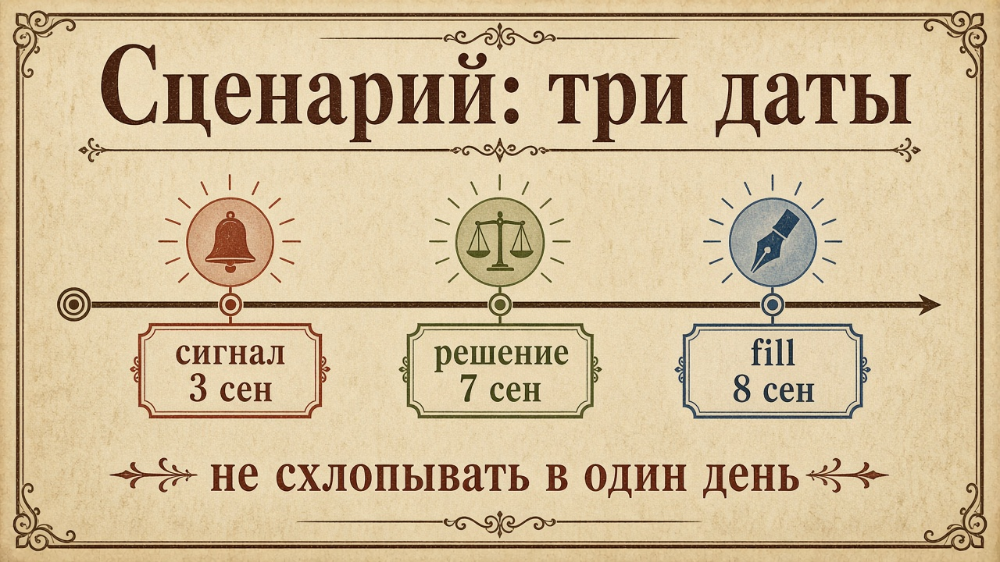

# Сценарий — три даты одного следа

## Визуальный ориентир

*Сигнал / решение / fill раздельно. Иллюстрация Vault; не скриншот приёмки.*

## Зачем

Не дать журналу склеить сигнал, решение и исполнение. Учебные даты из ревью владельца 2026-10-30: сигнал 2026-09-03, отметка решения 2026-09-07, исполнения 2026-09-08. Это иллюстрация контракта, не утверждение, что в базе владельца лежат именно такие строки: содержимое портфеля #5 независимо в Vault не проверялось.

## Шаги

1. Открыть бумажный журнал на известном mount (см. [[Сценарий — Shadow не берёт сегодняшний open]] про проверку, что код тот).
2. Найти день сигнала. В нём может не быть исполнений. Это нормально, если fill датирован следующим торговым днём.
3. Найти связанные ордера по устойчивому идентификатору, не по соседству на экране.
4. Убедиться, что статус исполнения относится к дате fill, а не рисует «исполнено» уже в день сигнала.
5. Не требовать P&L этой цепочки. Пока нет лотовой атрибуции и цен as-of, блок результата либо отсутствует, либо явно говорит, чего не хватает. Ноль рублей здесь — провал.
6. Если след старый и в нём нет записанной причины, журнал говорит «причина не записана». Он не сочиняет текст задним числом.

## Провал

Одна дата на все три смысла. Английские сырые статусы как единственный язык карточки — отдельный долг приёмки вида, даже если даты верные. NAV, построенный так, будто 2026-09-03 уже знал цену исполнения 2026-09-08.

См. [[Decision vs Order vs Fill]].
