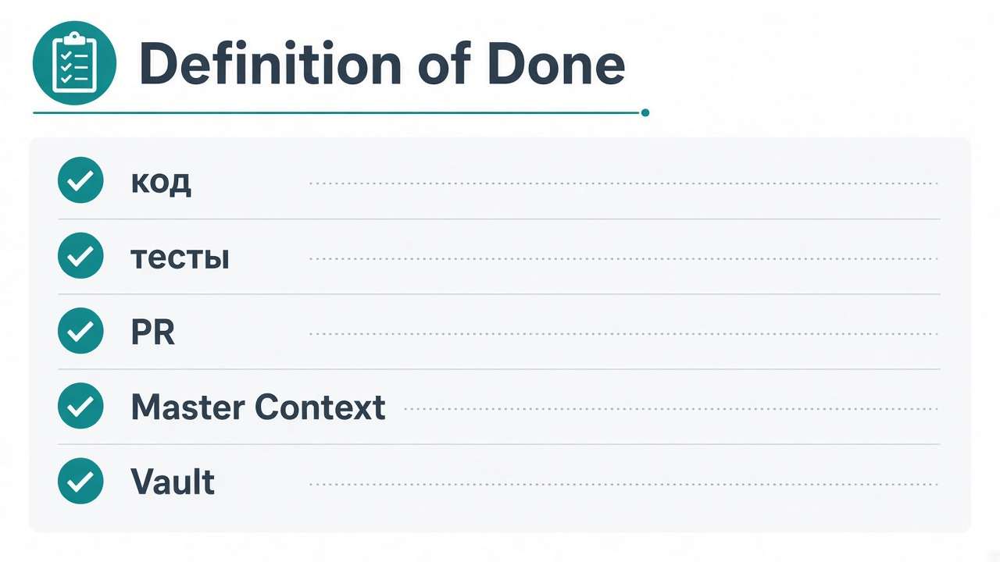

# Definition of Done

## Визуальный ориентир

*Код, тесты, PR, контекст, Vault. Иллюстрация Vault.*

Работа закончена не когда diff сохранился, а когда выполнены все пункты, которые относятся к её риску. Лишнее, сделанное «заодно», — признак незакрытой границы, не щедрость.

## Для любой задачи

- заявленный объём есть, соседний объём не приехал в том же diff;
- нет секретов;
- отчёт говорит, какие проверки запускались и на каком SHA, а какие нет;
- документация, которую задача обязана была поправить, поправлена;
- значимое событие отражено в Master Context либо честно названо, почему обновление не влито.

## По виду изменения

| Изменение | Минимум |
|---|---|
| Текст, план, Vault | ссылки и пути, без полного CI |
| Внешний вид | точечные проверки фронта и браузер на известном mount; полный завод — на воротах интеграции |
| Журнал, NAV, комиссия, миграция, Shadow | целевые регрессии и полный уместный CI до merge; Docker, если затронут runtime |
| Релиз | отдельная команда владельца, `VERSION` или manifest по правилам выпуска, tag только если релиз официальный |

Зелёный прогон на другом коммите не закрывает этот. Пропущенный полный CI по политике соразмерности не отменяет проверку, которая соответствует риску.

## Для интерфейса инвестора

Поведение пройдено как путь, не как один скриншот. Соседние экраны, которые читают те же данные, не разъехались. Пустое, ошибочное и частичное состояния живы. Узкий экран смотрят, если менялась вёрстка. Если браузер недоступен, говорят, чем заменили и чего не увидели.

Вид, который владелец уже отверг, не становится «готово» из-за merge.

## Для Vault

Заметка объясняет своими словами, ссылается на источник, не выдаёт план за код и не выдаёт код за принятый продукт. Пустой файл-заготовка покрытием не считается.

## Когда не готово

Нет SHA. Нет слова, чей mount смотрели. Финансовый ноль стоит на месте дыры. В diff брокер, сеть или новая версия датасета, которых не просили. Контекст говорит «готово», а PR всё ещё открыт.
