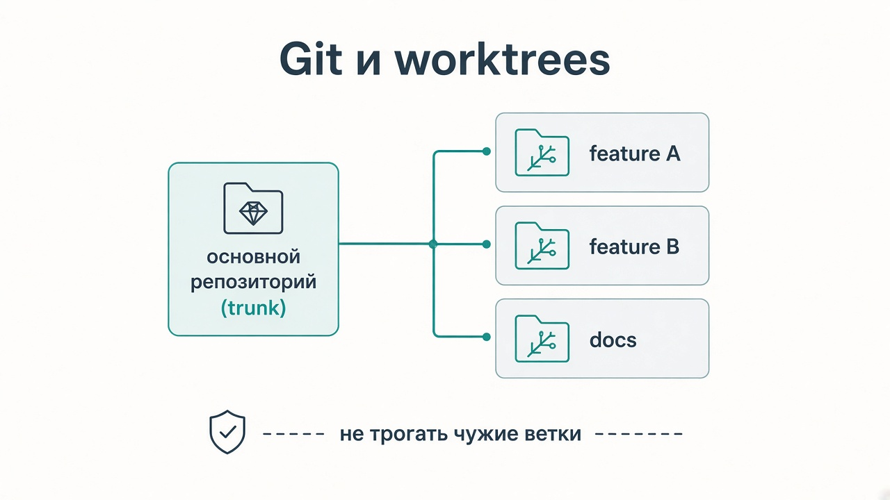

# Git и worktrees

## Визуальный ориентир

*Изоляция веток, чужие деревья не трогать. Иллюстрация Vault.*

Несколько рабочих копий одного репозитория — нормальный способ не мешать параллельным задачам. Каждая копия — свой каталог и своя ветка. Общий объектный склад git один.

## Обычный цикл

`main` → ветка задачи → код и тесты → коммит → push → pull request → замечания → merge обычным merge-коммитом, если его разрешили.

В `main` напрямую функциональную работу не ведут, если прямо не сказали иначе. Историю `main` не переписывают. Force-push не используют. Чужие незакоммиченные файлы не выбрасывают и не прячут в stash «чтобы было чисто».

Коммит — одна логическая правка. Сообщение говорит зачем. Привычные префиксы: feat, fix, refactor, test, docs, chore. Сообщение `changes` не объясняет ничего.

## Что проверить перед правкой

1. `git fetch origin`
2. Какой каталог открыт и какая в нём ветка
3. Нет ли в этом каталоге чужой грязной работы
4. Не этот ли каталог примонтирован в уже запущенный frontend

Docker запоминает путь запуска. Починка в соседнем worktree не видна в браузере, пока mount смотрит сюда. После merge полезно вернуть runtime на актуальный main, не снося тома. См. [[Устаревший Docker mount]].

## Ветки, которые не путают

- ветка функции — код продукта;
- `review-artifacts` — скриншоты для ревью, её не сливают в продукт;
- Vault `E:\kraken Vault` — вообще другой каталог, пока без своего git. Не коммитьте заметки Vault в ProjectAI и не инициализируйте репозиторий Vault, пока владелец не разрешит.

## Чего не делать

Интерактивный rebase, жёсткий reset, удаление миграций, правка чужой ветки «чтобы помочь», merge без разрешения. Если фоновая задача оборвалась, сначала смотрят, какие файлы она задела, и не откатывают их молча.
