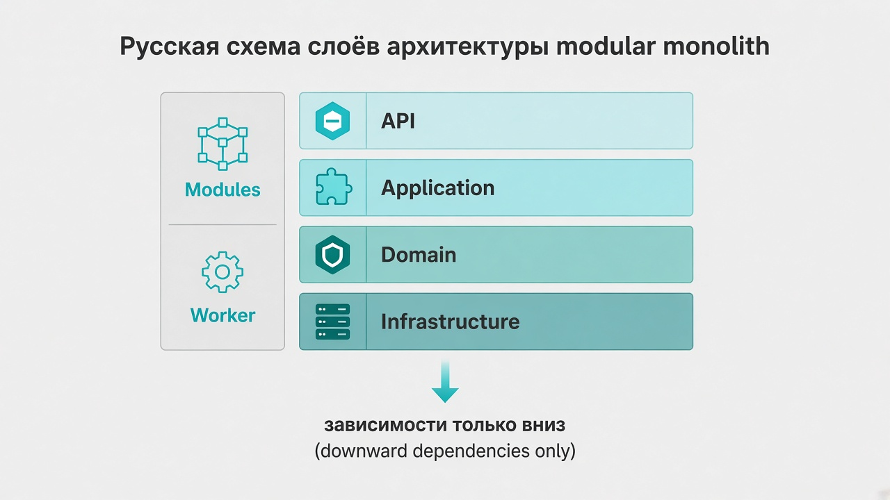

# Как устроен код


## Визуальный ориентир



*Слои modular monolith. Иллюстрация Vault.*

ProjectAI — модульный монолит. Один backend, много пакетов, две базы, отдельный frontend. Kraken — имя продукта, каталога `modules/kraken` нет и не нужно заводить.

## Куда смотреть

```text
backend/app/modules/*     предметные пакеты
backend/app/api           HTTP-границы
frontend/src/pages        экраны
frontend/src/features     куски интерфейса
frontend/src/version      заметки релизов для инвестора
docs/architecture         устройство и ADR
docs/product              продуктовые договоры
docs/development          как работаем и какой статус
```

Пакеты на main включают рынок, портфель, Shadow, прогноз, риск, intelligence, исследования, симулятор, память. Наличие пакета не значит завершённость. Паспорт модуля, когда он появится в разделе архитектуры Vault, подробнее любого этого списка.

## Как течёт личный рубль

Журнал операций → проекция кэша и позиций → снимок личного портфеля → экраны. Аналитика не читает сырой остаток как второй источник. Shadow и research в этот снимок не подмешиваются.

## Как течёт решение

Прогноз не создаёт ордер. Политика предлагает. Риск может запретить. Исполнение только проводит намерение. Для бумаги исполнение — следующее допустимое открытие. Для человека исполнение — запись, которую он ввёл сам.

Доменный код не должен импортировать веб-фреймворк, ORM, очередь, клиент брокера или конкретную библиотеку моделей. Адаптер живёт снаружи.

## Две базы

Операционные данные и [[Decision Memory DB]] разделены. Миграции у каждой свои. Удалять старую миграцию нельзя. Схема меняется новым файлом ревизии.

## Версии, которые легко смешать

| Место | Что это |
|---|---|
| `VERSION` | технический SemVer, сейчас 1.0.0 |
| `manifest.ts` | текст «О Kraken», сейчас метка 1.05 |
| git tag | только официальный релиз; есть `v1.0.0` |
| спецификация датасета | договор колонок, не номер приложения |

Менять смысл признаков под старым именем спецификации нельзя.

См. [[Modular monolith]] и [[Git и worktrees]].
