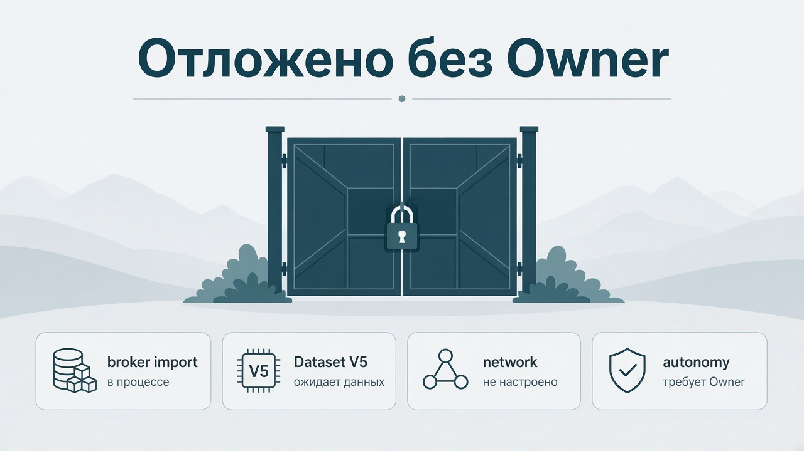

# Правила безопасности

## Визуальный ориентир

*Секреты, сеть и автономия — только с Owner. Иллюстрация Vault.*

Безопасность здесь — и про секреты, и про деньги, и про чужую работу.

## Секреты

В git и в Vault не попадают ключи, пароли, файлы окружения, брокерские токены, персональные выгрузки журнала и дампы баз. Их не печатают в логах, в ответах API и в проверках здоровья. Если секрет уже попал в diff, его не «чуть-чуть оставляют», а выкидывают из коммита и считают скомпрометированным.

## Деньги и данные

Живой портфель владельца не служит песочницей. Для проверки есть тестовый портфель и фикстуры. Читать живые данные можно, если состояние не меняется. Общую рыночную историю и след Shadow не удаляют ради уборки.

Не переписывают личный журнал задним числом. Не ставят ноль вместо неизвестной цены или комиссии. Не исполняют бумажный ордер по уже известной цене. Не включают реальную заявку.

## Сетка и доступы

Порты, привязки, firewall и охват баз с 2026-10-28 не меняют ни в какой попутной задаче. USER/OWNER не защищает компьютер: это только подробность экрана. Пока нет настоящего разграничения, не обещайте, что данные изолированы между людьми.

## Работа рядом с другими

Несколько агентов и людей могут держать worktree. Нельзя сбрасывать чужое, переписывать чужую ветку и останавливать чужой контейнер с томами, чтобы «починить себе localhost». Сначала узнайте, чей процесс слушает порт.

Внешнее хранилище исторической выгрузки, если оно подключено у владельца, не место для экспериментов и удаления.

## Автономия

Любая возможность послать заявку или самому торговать — отдельный этап с отдельным разрешением. Случайно появившийся клиент брокера в несвязанной задаче — дефект безопасности, не бонус.
